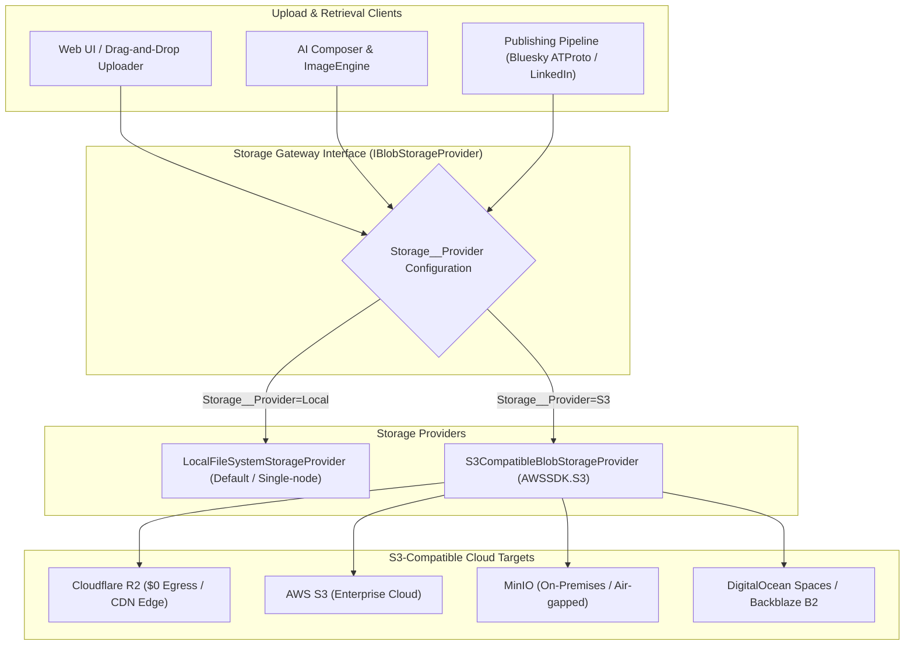

# Implementation Plan: S3-Compatible Cloud Blob Storage Subsystem

We propose adding a first-class **Cloud Blob Storage Subsystem** (`IBlobStorageProvider`) to SocialWorker. This replaces the hardcoded local filesystem dependency (`FileStorageProvider`) with a pluggable storage architecture supporting **Cloudflare R2**, **AWS S3**, **MinIO**, **DigitalOcean Spaces**, and **Local FileSystem**.

---

## 1. Motivation & Commercial Value



### Why This is Essential for Commercial Viability:
1. **Stateless API Replicas**: Multiple `api` container instances can run behind a load balancer without needing shared NFS volumes or persistent volume synchronization.
2. **Zero-Egress Cost with Cloudflare R2**: High-resolution image carousels, video attachments, and banners incur $0 bandwidth costs.
3. **Direct Browser Pre-signed Uploads**: Large media files (e.g. 50MB audio files or high-res images) can be uploaded directly from the browser to Cloudflare R2 / S3 without blocking the ASP.NET Core API server threads.
4. **Air-Gapped On-Premises Deployment**: Regulated enterprises (defense, healthcare, fintech) can route storage to their internal **MinIO** cluster with standard S3 credentials.

---

## 2. Core Architecture & Interface Design

### A. Storage Interface: `IBlobStorageProvider.cs` (`Features/Media/Services/`)

```csharp
namespace SocialWorker.Api.Features.Media;

public interface IBlobStorageProvider
{
    /// <summary>
    /// Saves a stream as a blob at the specified path.
    /// </summary>
    Task<string> SaveBlobAsync(string path, Stream data, string contentType, CancellationToken ct = default);

    /// <summary>
    /// Gets a readable stream for the blob at the specified path.
    /// </summary>
    Task<Stream?> GetBlobStreamAsync(string path, CancellationToken ct = default);

    /// <summary>
    /// Gets the full byte content for the blob at the specified path.
    /// </summary>
    Task<byte[]?> GetBlobBytesAsync(string path, CancellationToken ct = default);

    /// <summary>
    /// Checks if a blob exists at the specified path.
    /// </summary>
    Task<bool> ExistsAsync(string path, CancellationToken ct = default);

    /// <summary>
    /// Deletes the blob at the specified path.
    /// </summary>
    Task DeleteBlobAsync(string path, CancellationToken ct = default);

    /// <summary>
    /// Gets the public CDN or API URL for direct client access.
    /// </summary>
    string GetPublicUrl(string path);

    /// <summary>
    /// Generates a pre-signed PUT URL for direct browser-to-bucket upload.
    /// </summary>
    Task<string?> GeneratePresignedUploadUrlAsync(string path, TimeSpan expiry, string contentType, CancellationToken ct = default);

    /// <summary>
    /// Generates a pre-signed GET URL for temporary private download.
    /// </summary>
    Task<string?> GeneratePresignedDownloadUrlAsync(string path, TimeSpan expiry, CancellationToken ct = default);
}
```

---

## 3. Implementations

### 1. `LocalFileSystemStorageProvider.cs`
- Used when `Storage__Provider=Local` (default for development and unit testing).
- Stores files under `/app/uploads` (or configurable root).
- Implements `IBlobStorageProvider` with local `FileStream` and `File.WriteAllBytesAsync`.
- Pre-signed URLs return relative API streaming endpoints (`/api/media/{id}`).

### 2. `S3CompatibleBlobStorageProvider.cs`
- Used when `Storage__Provider=S3`.
- Backed by standard `AWSSDK.S3` NuGet package (`AmazonS3Client`).
- Works universally across **Cloudflare R2**, **AWS S3**, **MinIO**, and **DigitalOcean Spaces**.
- Supports:
  - Custom `ServiceURL` (e.g. `https://<account_id>.r2.cloudflarestorage.com` or `http://minio:9000`).
  - `ForcePathStyle` configuration for MinIO / local S3 emulators.
  - Public CDN base URL (e.g. `https://media.mycompany.com`) for instant 302 redirection or direct URL emission.
  - Pre-signed upload & download URLs via `GetPreSignedURLRequest`.

---

## 4. Configuration Schema (`.env` & `appsettings.json`)

```ini
# Storage Provider Selection: Local | S3
Storage__Provider=Local

# S3 Configuration (Cloudflare R2, AWS S3, MinIO, DO Spaces)
Storage__S3__ServiceUrl=https://<account-id>.r2.cloudflarestorage.com
Storage__S3__BucketName=social-worker-media
Storage__S3__AccessKey=your-access-key-id
Storage__S3__SecretKey=your-secret-access-key
Storage__S3__Region=auto
Storage__S3__PublicBaseUrl=https://media.mybrand.com
Storage__S3__ForcePathStyle=false
```

---

## 5. Integration Across Existing Subsystems

1. **`MediaService` (`Features/Media/Services/MediaService.cs`)**:
   - Injects `IBlobStorageProvider` instead of concrete `FileStorageProvider`.
   - Stores media assets, extracts dimensions/metadata, and computes storage paths (`drafts/{draftId}/{assetId}_{fileName}`).
2. **`MediaEndpoint` (`Features/Media/MediaEndpoint.cs`)**:
   - `GET /api/media/{id}`:
     - If public CDN configured on S3: returns `302 Found` with direct CDN URL.
     - Otherwise: streams the blob via `Results.Stream(stream, mimeType)`.
   - `POST /api/media/presigned-upload`:
     - Returns `{ uploadUrl, assetId, storagePath }` allowing direct frontend uploads.
3. **`ImageEngine` & Template Rendering**:
   - Rendered carousel slides and banner PNGs stream directly to `IBlobStorageProvider.SaveBlobAsync`.
4. **Publishing Pipeline (`BlueskyContentPreparationService`, `LinkedInPublishService`)**:
   - Fetches blob byte streams via `IBlobStorageProvider.GetBlobBytesAsync` for ATProto blob upload and LinkedIn asset upload.
5. **Sources & Transcripts**:
   - Uploaded source documents (PDFs, research notes) and Whisper audio transcripts stored cleanly in blob storage (`transcripts/{sourceId}.json`).

---

## 6. Verification & Test Plan

1. **Unit Tests (`SocialWorker.Api.Tests/Features/Media/`)**:
   - `LocalFileSystemStorageProviderTests`: Round-trip upload, read, existence, deletion, directory creation.
   - `S3CompatibleBlobStorageProviderTests`: Mocked `IAmazonS3` client verifying PUT object requests, pre-signed URL generation, path formatting, and public URL resolution.
2. **Integration & Concurrency Tests**:
   - Concurrent blob uploads with duplicate filenames (ensuring unique UUID paths).
   - Direct streaming vs CDN redirection verification.
3. **Docker Stack Verification**:
   - Run stack with `Storage__Provider=Local` and verify all media upload/template render tests pass.
   - Run stack against a test MinIO/R2 bucket to verify S3 protocol compliance.
