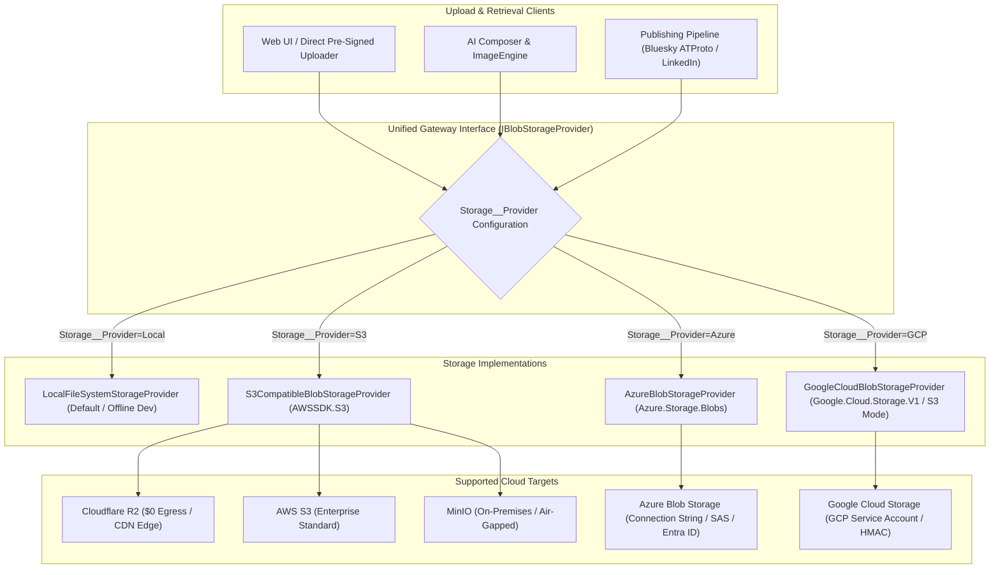

# Implementation Plan: Multi-Cloud Blob Storage Subsystem (AWS S3, R2, MinIO, Azure & GCP)

We propose adding a pluggable **Multi-Cloud Blob Storage Subsystem** (`IBlobStorageProvider`) to SocialWorker. This replaces the hardcoded local filesystem dependency (`FileStorageProvider`) with a unified storage architecture supporting **Cloudflare R2**, **AWS S3**, **MinIO**, **Microsoft Azure Blob Storage**, **Google Cloud Storage (GCS)**, and **Local FileSystem**.

---

## 1. Multi-Cloud Architecture & Motivation



### Strategic Commercial Value:
1. **Total Cloud Vendor Neutrality**: Enables deployments on AWS, Cloudflare, Microsoft Azure, Google Cloud, or on-premises Kubernetes with zero vendor lock-in.
2. **Stateless API Scaling**: Multiple `api` container replicas can run behind a load balancer without needing shared NFS volumes.
3. **Zero-Egress Cost with Cloudflare R2**: High-resolution image carousels, video attachments, and banners incur $0 egress fees.
4. **Direct Pre-signed Browser Uploads**: Media files upload directly from client browsers to S3/R2/Azure/GCS without bottlenecking the ASP.NET Core API server threads.
5. **Enterprise Compliance**: Meets enterprise IT requirements for **Azure Managed Identity (Entra ID)** and **AWS IAM Roles**.

---

## 2. Core Interface: `IBlobStorageProvider.cs` (`Features/Media/Services/`)

```csharp
namespace SocialWorker.Api.Features.Media;

public interface IBlobStorageProvider
{
    /// <summary>
    /// Saves a stream as a blob at the specified path.
    /// </summary>
    Task<string> SaveBlobAsync(string path, Stream data, string contentType, CancellationToken ct = default);

    /// <summary>
    /// Gets a readable stream for the blob at the specified path.
    /// </summary>
    Task<Stream?> GetBlobStreamAsync(string path, CancellationToken ct = default);

    /// <summary>
    /// Gets the full byte content for the blob at the specified path.
    /// </summary>
    Task<byte[]?> GetBlobBytesAsync(string path, CancellationToken ct = default);

    /// <summary>
    /// Checks if a blob exists at the specified path.
    /// </summary>
    Task<bool> ExistsAsync(string path, CancellationToken ct = default);

    /// <summary>
    /// Deletes the blob at the specified path.
    /// </summary>
    Task DeleteBlobAsync(string path, CancellationToken ct = default);

    /// <summary>
    /// Gets the public CDN or API URL for direct client access.
    /// </summary>
    string GetPublicUrl(string path);

    /// <summary>
    /// Generates a pre-signed PUT/POST URL for direct browser-to-bucket upload.
    /// </summary>
    Task<string?> GeneratePresignedUploadUrlAsync(string path, TimeSpan expiry, string contentType, CancellationToken ct = default);

    /// <summary>
    /// Generates a pre-signed GET URL for temporary private download.
    /// </summary>
    Task<string?> GeneratePresignedDownloadUrlAsync(string path, TimeSpan expiry, CancellationToken ct = default);
}
```

---

## 3. Storage Provider Implementations

### 1. `LocalFileSystemStorageProvider.cs`
- Used when `Storage__Provider=Local` (default for development and unit testing).
- Stores files under `/app/uploads` (or configurable root).
- Implements `IBlobStorageProvider` with local `FileStream` and `File.WriteAllBytesAsync`.

### 2. `S3CompatibleBlobStorageProvider.cs`
- Used when `Storage__Provider=S3`.
- Backed by standard `AWSSDK.S3` NuGet package (`AmazonS3Client`).
- Connects to **Cloudflare R2**, **AWS S3**, **MinIO**, **DigitalOcean Spaces**, **Backblaze B2**, and **GCP (S3-mode)**.
- Full pre-signed upload & download URL support.

### 3. `AzureBlobStorageProvider.cs`
- Used when `Storage__Provider=Azure`.
- Backed by official `Azure.Storage.Blobs` NuGet package (`BlobServiceClient`, `BlobContainerClient`).
- Supports Connection Strings, SAS tokens, and Azure Managed Identity / Entra ID.
- SAS URL generation for direct browser uploads.

### 4. `GoogleCloudBlobStorageProvider.cs`
- Used when `Storage__Provider=GCP`.
- Connects either via **S3 Interoperability Mode** (using `S3CompatibleBlobStorageProvider` + HMAC keys) or native `Google.Cloud.Storage.V1` with Service Account credentials (`GOOGLE_APPLICATION_CREDENTIALS`).

---

## 4. Configuration Schema (`.env` & `appsettings.json`)

```ini
# Storage Provider Selection: Local | S3 | Azure | GCP
Storage__Provider=Local

# --- S3 Compatible (Cloudflare R2, AWS S3, MinIO, DO Spaces, GCP S3-mode) ---
Storage__S3__ServiceUrl=https://<account_id>.r2.cloudflarestorage.com
Storage__S3__BucketName=social-worker-media
Storage__S3__AccessKey=your-access-key-id
Storage__S3__SecretKey=your-secret-access-key
Storage__S3__Region=auto
Storage__S3__PublicBaseUrl=https://media.mybrand.com
Storage__S3__ForcePathStyle=false

# --- Microsoft Azure Blob Storage ---
Storage__Azure__ConnectionString=DefaultEndpointsProtocol=https;AccountName=myaccount;AccountKey=...;EndpointSuffix=core.windows.net
Storage__Azure__ContainerName=media
Storage__Azure__PublicBaseUrl=https://mycdn.azureedge.net/media

# --- Google Cloud Storage ---
Storage__Gcp__BucketName=my-gcp-media-bucket
Storage__Gcp__CredentialFilePath=/app/gcp-credentials.json
Storage__Gcp__PublicBaseUrl=https://storage.googleapis.com/my-gcp-media-bucket
```

---

## 5. Integration Across Subsystems

1. **`MediaService` (`Features/Media/Services/MediaService.cs`)**:
   - Injects `IBlobStorageProvider` instead of concrete `FileStorageProvider`.
   - Stores media assets, extracts dimensions/metadata, and computes storage paths (`drafts/{draftId}/{assetId}_{fileName}`).
2. **`MediaEndpoint` (`Features/Media/MediaEndpoint.cs`)**:
   - `GET /api/media/{id}`:
     - If public CDN configured: returns `302 Found` with direct CDN URL.
     - Otherwise: streams the blob via `Results.Stream(stream, mimeType)`.
   - `POST /api/media/presigned-upload`:
     - Returns `{ uploadUrl, assetId, storagePath }` allowing direct frontend uploads.
3. **`ImageEngine` & Template Rendering**:
   - Rendered carousel slides and banner PNGs stream directly to `IBlobStorageProvider.SaveBlobAsync`.
4. **Publishing Pipeline (`BlueskyContentPreparationService`, `LinkedInPublishService`)**:
   - Fetches blob byte streams via `IBlobStorageProvider.GetBlobBytesAsync` for ATProto blob upload and LinkedIn asset upload.
5. **Sources & Transcripts**:
   - Uploaded source documents (PDFs, research notes) and Whisper audio transcripts stored cleanly in blob storage (`transcripts/{sourceId}.json`).

---

## 6. Verification & Test Plan

1. **Unit Tests (`SocialWorker.Api.Tests/Features/Media/`)**:
   - `LocalFileSystemStorageProviderTests`: Upload, read, delete, directory auto-creation.
   - `S3CompatibleBlobStorageProviderTests`: Mocked `IAmazonS3` client verifying PUT requests, pre-signed URL generation, and CDN redirection.
   - `AzureBlobStorageProviderTests`: Mocked `BlobServiceClient` / `BlobContainerClient` verifying blob uploads, SAS generation, and streaming.
2. **Docker Stack Verification**:
   - Run stack with `Storage__Provider=Local` and verify all media upload and template rendering tests pass.
   - Test against MinIO and Cloudflare R2 in staging environments.
