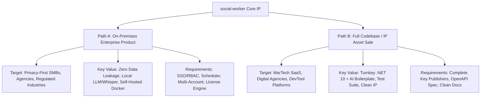
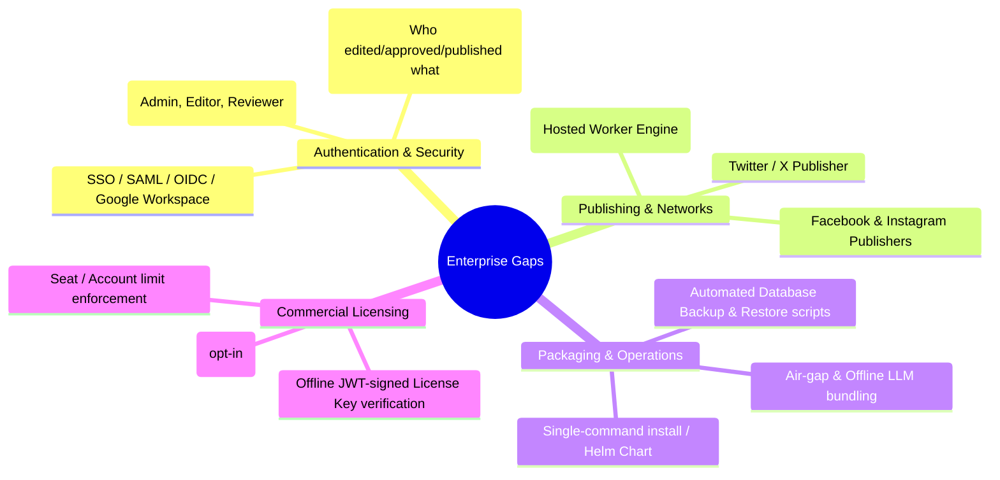

# Commercial Viability & Asset Sale Evaluation: social-worker

## Executive Summary

**social-worker** is a modern, local-first, multi-modal AI assistant designed for content creators, marketing teams, and organizations to draft, refine, source, format, and publish multi-segment social media threads.

Built with a high-performance stack (**ASP.NET Core .NET 10 Minimal APIs**, **PostgreSQL 16**, **React + Vite + Tailwind CSS**, **Microsoft.Extensions.AI**, **Docker Compose**, local **Whisper** transcription, and **SearXNG** private search), the codebase exhibits exceptionally high architectural hygiene, modularity, and test discipline (105+ unit/integration tests, Vitest frontend tests, and containerized Playwright E2E).

This evaluation investigates two monetization pathways:
1. **Option A — On-Premises / Self-Hosted Product for Small Enterprises (SMBs, Agencies, Regulated Firms)**
2. **Option B — Full Codebase / IP Asset Sale to a Third Party**

---

## 1. Codebase & Architectural Readiness Audit

### 1.1 Technical Strengths & Commercial Assets

| Area | Current Implementation State | Commercial / Sale Impact |
| :--- | :--- | :--- |
| **Backend Core** | .NET 10 C# Minimal APIs with clean vertical slice architecture (`Features/` layout), EF Core, typed records, static factory methods. | **High Asset Value**: Highly maintainable, enterprise-grade, modern LTS foundation. Zero legacy technical debt. |
| **AI Integration** | `Microsoft.Extensions.AI` abstraction layer supporting OpenRouter, OpenAI, and local Ollama (`ILlmProviderAdapter`, dynamic tool registration, streaming SSE). | **Major Enterprise Selling Point**: Customers can point to internal/local models (Ollama, vLLM) with zero data leaving their network. |
| **Transcription & Sourcing** | Dedicated Python FastAPI container running local Whisper models + `yt-dlp` scraping; SearXNG container for private search; RSS/Feed polling hosted background service. | **Turnkey Multimedia Ingestion**: Eliminates 3rd-party SaaS subscription costs for transcription and web scraping. |
| **Test Quality & Coverage** | 100+ backend unit and integration tests under xUnit, frontend unit tests in Vitest, and end-to-end Dockerized Playwright tests with mock LLM profiles (`DemoLlmAdapter`). | **Due Diligence Ready**: Buyers or enterprise IT auditors will find high confidence, reproducible CI, and strong regression protection. |
| **Publishing Pipeline** | Bluesky thread publishing (AT Protocol) and LinkedIn single-post publishing (OAuth + rich text contract mapping). Enforces stage gates (`RoughDraft` → `Sourcing` → `Refining` → `Formatting` → `Ready` → `Sent`). | **Reliable Core**: Strict server-enforced validation prevents malformed posts from reaching social networks. |
| **Automation & Ingestion** | RSS / Feed ingestion queue with hosted worker, backoff retries, and decoupled workflow destinations. | **High Automation Potential**: Enables automated content curation pipelines from corporate blogs/news to social channels. |

---

## 2. Option A: Selling as an On-Premises / Self-Hosted Product

### 2.1 Target Customer Profiles & Value Proposition

Small and mid-market enterprises (SMBs) and boutique marketing agencies face significant data compliance and cost hurdles when using public SaaS tools (Buffer, Hootsuite, Sprout Social) combined with cloud LLMs:

1. **Regulated & Privacy-Conscious SMBs (Legal, Healthcare, FinTech, Defense/Gov contractors)**:
   - *Problem*: Cannot paste internal memos, draft whitepapers, or confidential research into third-party cloud SaaS or public AI models due to GDPR, HIPAA, SOC 2, or client NDAs.
   - *Value Proposition*: 100% self-hosted, air-gappable deployment. Runs on internal infrastructure using local Ollama LLMs and local Whisper transcription. Zero data leaves corporate perimeter.
2. **Digital Marketing & Content Agencies**:
   - *Problem*: High per-seat SaaS costs across dozens of client accounts and disparate tools for transcription, drafting, and multi-network formatting.
   - *Value Proposition*: Single self-hosted appliance handling multi-account workflows, brand voice prompts per client, automated RSS ingestion, and automated thread composition.
3. **Executive Communications / Thought Leadership Teams**:
   - *Problem*: Complex approval loops required before publishing; risk of AI hallucinating or posting unverified claims.
   - *Value Proposition*: Strict stage gating (`Draft` → `Ready` → `Sent`) where AI assists drafting but cannot publish without explicit human approval.

---

### 2.2 Enterprise Gap Analysis (What is Missing for On-Premise Sales)

To command enterprise license pricing ($250 – $1,500/month or $3,000 – $15,000/year per instance), the following gaps must be addressed:

#### Gap Details:

1. **Authentication & RBAC (Role-Based Access Control)**:
   - *Current*: Basic JWT auth with single user or basic admin/user role.
   - *Requirement*: Enterprise Single Sign-On (OIDC / SAML 2.0 / Azure AD / Okta / Google Workspace), plus granular roles (`Admin`, `Content Creator`, `Reviewer/Approver`, `Viewer`).
2. **Scheduled Publishing**:
   - *Current*: Immediate manual publishing only.
   - *Requirement*: Background scheduling engine allowing users to schedule threads across multiple time zones with approval deadlines.
3. **Platform Breadth (Publishers)**:
   - *Current*: Bluesky (production), LinkedIn (production single-post), Twitter/Facebook/Instagram (stubs).
   - *Requirement*: Activating Twitter/X and Meta (Facebook Pages / Instagram Creator) via standard OAuth app setup guides for enterprise customers.
4. **License Management & Packaging**:
   - *Current*: Open Docker Compose file running from source or GHCR images.
   - *Requirement*: Commercial licensing engine (asymmetric RSA/ECDSA-signed license tokens embedded in `.env` verifying expiration date and seat limits offline), accompanied by a polished installation wizard or Helm chart.
5. **Audit Logging & Compliance**:
   - *Current*: Standard console application logs.
   - *Requirement*: Tamper-evident audit log table recording every prompt, stage change, source ingestion, and publish event with timestamp and user ID.

---

### 2.3 Proposed Packaging & Pricing Models

| Tier | Target Audience | Deployment | Key Features | Suggested Price |
| :--- | :--- | :--- | :--- | :--- |
| **Team / Agency** | 5–15 seats, boutique agencies, tech SMBs | Docker Compose (1-click script) | All social publishers, RSS automation, Brand Voice profiles, cloud/local LLMs | **$199 / month** or **$1,990 / year** |
| **Enterprise Self-Hosted** | Regulated firms, healthcare, legal, mid-market | Docker / Kubernetes Helm | SSO/SAML, Full Air-Gap (Ollama + local Whisper), Audit Logs, Custom SLA | **$799 / month** or **$7,990 / year** |
| **White-Label Agency License** | Marketing agencies serving multiple clients | Multi-tenant / Multi-instance | Re-brandable UI (custom logo/colors/domain), multi-client account isolation | **$12,000 one-time** + **$2,500/yr maintenance** |

---

## 3. Option B: Selling the Entire Codebase / IP Asset Sale

### 3.1 Potential Buyer Profiles

If electing to sell the intellectual property outright:

1. **SaaS Builders / Micro-Acquirers (e.g., Acquire.com, Flippa, Tiny Capital)**:
   - Buyers seeking a production-ready, ultra-modern .NET 10 + React AI platform to launch as a hosted SaaS or niche product without spending 6–12 months on R&D.
2. **Established MarTech / Social Media SaaS Providers**:
   - Companies wanting to acquire an AI-first thread composition engine, YouTube transcription pipeline, and AT Protocol/Bluesky native publishing tech to integrate into their existing platforms.
3. **AI Development Agencies / Consultancies**:
   - Agencies looking for an enterprise-grade AI reference architecture (dynamic function calling, streaming SSE, prompt management, vector/search integration) to repurpose for enterprise client projects.

---

### 3.2 Valuation Drivers & Asset Multipliers

| Valuation Driver | Codebase Factor | Status in Current Repository | Value Multiplier Impact |
| :--- | :--- | :--- | :--- |
| **Code Quality & Architecture** | Clean separation of concerns, vertical slices, EF Core best practices, no spaghetti code. | ⭐⭐⭐⭐⭐ (Excellent) | **High**: Low onboarding cost for buyer's engineering team. |
| **Test Coverage & Automated Verification** | Comprehensive xUnit, Vitest, and Playwright suites in Docker. | ⭐⭐⭐⭐⭐ (Excellent) | **High**: Buyers can refactor or extend with immediate confidence. |
| **Tech Stack Currency** | .NET 10, React 19/Vite, TypeScript, Tailwind, Docker Compose. | ⭐⭐⭐⭐⭐ (Latest LTS) | **High**: No immediate tech debt or obsolete frameworks. |
| **Completeness of Platform Connectors** | Live Bluesky and LinkedIn; stubbed Twitter, FB, IG. | ⭐⭐⭐☆☆ (Partial) | **Moderate**: Completing the stubbed publishers increases valuation significantly. |
| **Multi-Tenancy & Scheduling** | User/Account models exist; scheduled background job pending. | ⭐⭐⭐☆☆ (Partial) | **Moderate**: Adding scheduled publishing directly increases buyer appeal. |
| **Documentation & Runbooks** | `MENTAL_MODEL.md`, `PLAN.md`, `README.md`, planning specs. | ⭐⭐⭐⭐⭐ (Outstanding) | **High**: Exceptional due diligence readiness. |

---

### 3.3 Target Valuation Ranges for Codebase / IP Sale

- **As-Is IP / Codebase Sale (Current State)**:
  - *Estimated Valuation*: **$15,000 – $35,000** (Asset sale on Acquire.com / private sale to developer/agency).
  - *Basis*: ~500–800 hours of senior engineering work saved, modern .NET 10/React architecture, working AI pipeline, Whisper transcription, Bluesky + LinkedIn publishing, complete test suites.
- **Enhanced IP Sale (Post-Hardening: Scheduling + Twitter/Meta publishers completed + Multi-tenant RBAC)**:
  - *Estimated Valuation*: **$50,000 – $100,000+** (Turnkey commercial-ready platform with full social network coverage).
