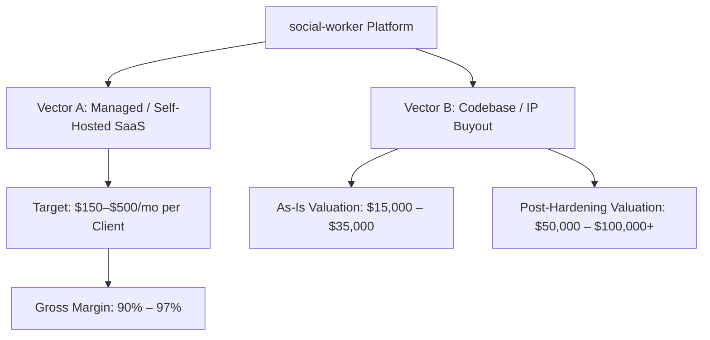
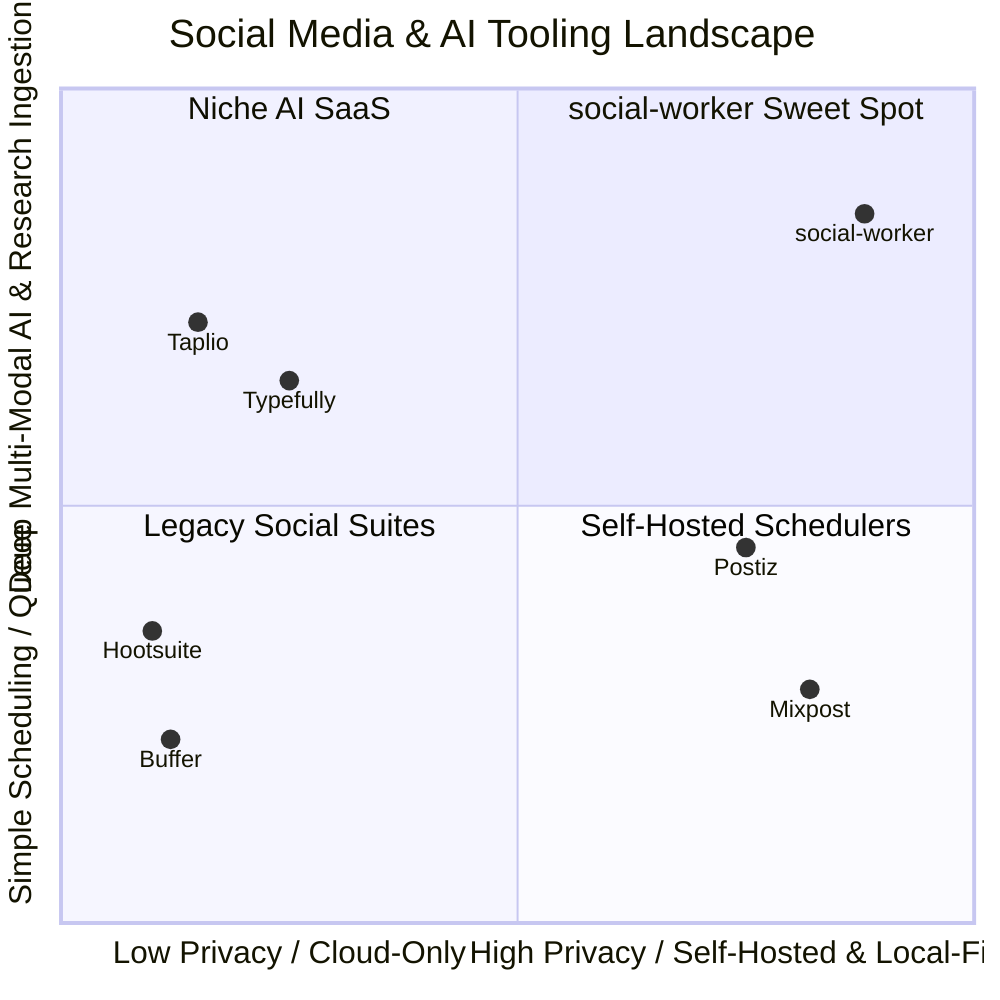
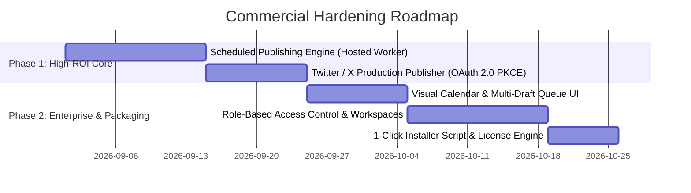

# Master Commercial Strategy & Market Launch Brief: social-worker

## Executive Overview

**social-worker** is positioned as a **local-first, privacy-native AI thread studio and automated content engine**. Built on **ASP.NET Core .NET 10**, **PostgreSQL 16**, **React/Vite/Tailwind**, and containerized local services (**Whisper** transcription and **SearXNG** private search), it provides a secure, air-gappable alternative to public cloud social media SaaS platforms.

This master brief summarizes the complete commercial feasibility, competitive positioning, operational cost model, and execution roadmap across both monetization vectors:
1. **Self-Hosted / Managed B2B Product for Agencies & Regulated Enterprises**
2. **Full Codebase / IP Asset Sale to MarTech Acquirers**

---

## 1. Commercial Vectors & Valuation

### 1.1 Vector A: Managed or On-Premises Service
- **Target Customers**: Privacy-conscious SMBs (legal, healthcare, fintech, defense contractors), thought leaders, and digital marketing agencies.
- **Key Value Proposition**: Zero data leakage, local-first LLM/Whisper inference, and human-in-the-loop stage gating preventing AI hallucinations from posting unverified claims.
- **Pricing Strategy**: $150 – $300/month for standard client instances; $500 – $800/month for high-touch enterprise/compliance deployments.

### 1.2 Vector B: Whole Codebase / IP Asset Sale
- **Target Acquirers**: SaaS builders (Acquire.com), established MarTech companies wanting an AI thread engine + AT Protocol/Bluesky native publisher, or enterprise devtool firms.
- **Valuation Driver**: Modern .NET 10 LTS stack, zero legacy debt, 105+ unit/integration tests, containerized Playwright E2E suites, and full multi-modal ingestion.

---

## 2. Competitive Positioning & "The Moat"

### Key Moats vs. Market Alternatives (Postiz, Mixpost, Typefully, Buffer):
1. **Zero Data Leakage Sovereignty**: Runs on internal infrastructure using Ollama and local Whisper in Docker. Enterprise data never leaves the network perimeter.
2. **Deep Multimedia Research Ingestion**: Automatically ingests 45-minute YouTube webinars/podcasts, runs Whisper transcription on-server, extracts insights, and formats segmented multi-platform threads in one continuous workflow.
3. **Lean Resource Efficiency**: Runs on a single 4 vCPU / 8 GB RAM VPS (~$15.50/mo), unlike competitor stacks (e.g. Postiz with Temporal, Redis, NestJS, and Next.js requiring 6–8 GB RAM).

---

## 3. Operational Cost & Profitability Model (3–4 Clients)

| Cost Component | Monthly Cost | Annual Cost (12 Months) | Notes |
| :--- | :--- | :--- | :--- |
| **Cloud VPS Server (Hetzner CPX31 - 4 vCPU, 8 GB RAM)** | $15.50 / mo | $186 / yr | Runs entire stack for 4–10 concurrent clients |
| **LLM Inference Tokens (Claude 3.5 Sonnet / OpenRouter)** | $22.50 / mo | $270 / yr | ~3.5M tokens/month (64 multi-platform threads) |
| **Audio Transcription & Search (Local Whisper + SearXNG)**| $0.00 / mo | $0 / yr | Handled on-server with zero incremental fees |
| **Social Network APIs (Bluesky, LinkedIn, FB, IG, Twitter)**| $0.00 / mo | $0 / yr | Free API tiers (Twitter free tier covers 1,500 tweets/mo) |
| **Domain, SSL & Encrypted Backups (Cloudflare R2)** | $2.00 / mo | $25 / yr | Offsite DB backups + Let's Encrypt SSL |
| **Contingency Buffer** | $5.00 / mo | $60 / yr | Buffer for token spikes or storage growth |
| **TOTAL 1-YEAR RUNNING COST** | **~$45.00 / mo** | **~$541 / yr** | **Ultra-lean operational baseline** |

### Projected Annual Profit Margin (4 Clients @ $250/mo):
- **Annual Gross Revenue**: **$12,000 / year**
- **Annual Operating Cost**: **$541 / year**
- **Annual Net Profit**: **$11,459 / year** (**95.5% Net Margin**)
- **Break-Even**: **1 client paying $50/month covers the entire platform infrastructure**.

---

## 4. Execution Roadmap: High-ROI Technical Milestones

To close key market gaps and maximize asset value, execution is structured around two immediate P1 features followed by enterprise hardening:

### 4.1 Milestone 1: Scheduled Publishing Engine
- *Documented in*: [`planning/SCHEDULED_PUBLISHING.md`](SCHEDULED_PUBLISHING.md)
- Database entity `ScheduledPublication`, hosted background polling service (`ScheduledPublishingHostedService`), queue API endpoints, and frontend date/time scheduling modal with countdown badges.

### 4.2 Milestone 2: Twitter / X Production Publisher
- *Documented in*: [`planning/TWITTER_SUPPORT.md`](TWITTER_SUPPORT.md)
- OAuth 2.0 PKCE flow, Twitter API v2 thread chaining (`in_reply_to_tweet_id`), 280 weighted-character validation, and live UI preview.

### 4.3 Milestone 3: Visual Calendar & Multi-Workspace Scoping
- Interactive calendar grid (monthly/weekly schedule) and workspace-scoped drafts for agencies managing multiple client brands.

---

## 5. Documentation Directory Index

All active planning assets and specifications are indexed in [`PLAN.md`](../PLAN.md):

| Document | Scope & Purpose |
| :--- | :--- |
| [`planning/COMMERCIAL_STRATEGY_MASTER.md`](COMMERCIAL_STRATEGY_MASTER.md) | Canonical master commercial strategy and launch brief |
| [`planning/COMMERCIAL_EVALUATION.md`](COMMERCIAL_EVALUATION.md) | In-depth enterprise B2B sales and codebase buyout feasibility study |
| [`planning/COMPETITIVE_BENCHMARK.md`](COMPETITIVE_BENCHMARK.md) | Competitive benchmark analysis vs. Postiz, Mixpost, Typefully, Taplio, and Buffer |
| [`planning/OPERATING_COST_ESTIMATE.md`](OPERATING_COST_ESTIMATE.md) | Granular 1-year operating budget and margin breakdown for 3–4 clients |
| [`planning/SCHEDULED_PUBLISHING.md`](SCHEDULED_PUBLISHING.md) | Background hosted worker, queue state machine, and UI scheduling design |
| [`planning/TWITTER_SUPPORT.md`](TWITTER_SUPPORT.md) | OAuth 2.0 PKCE connector and Twitter API v2 thread chaining architecture |
| [`planning/LINKED_IN.md`](LINKED_IN.md) | LinkedIn single-post publishing contract, rich text mapping, and OAuth pipeline |
