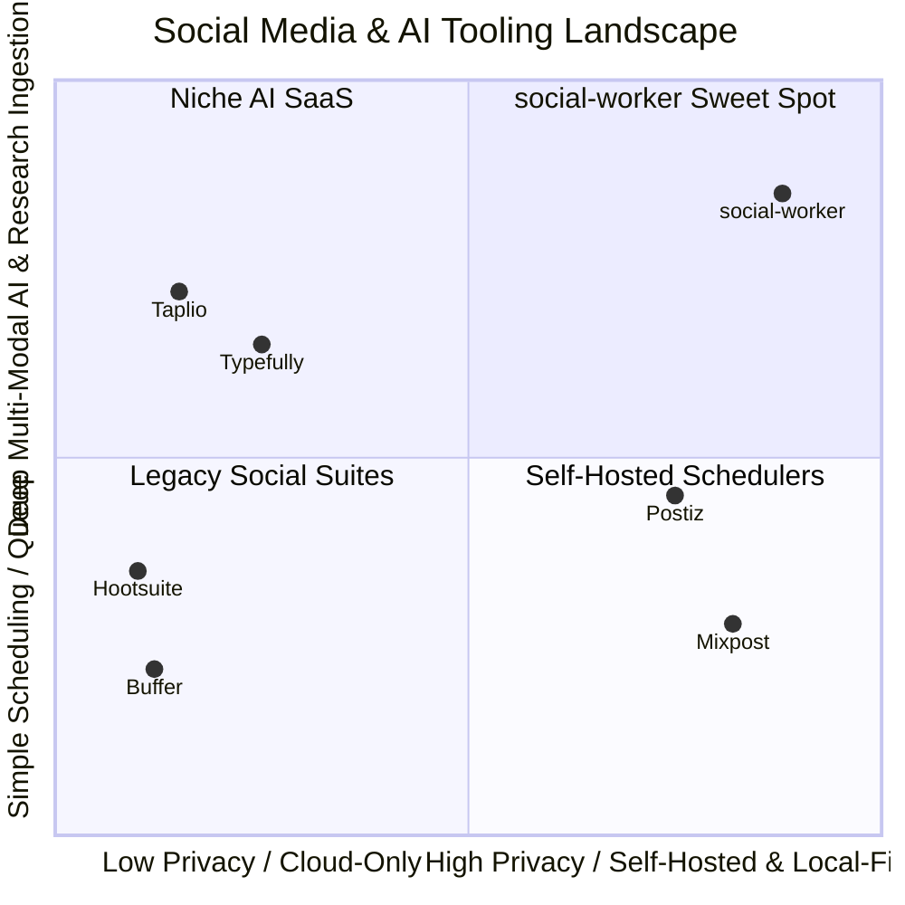

# Competitive Benchmark & Market Analysis: social-worker vs. Industry Solutions

## Executive Summary

This document benchmarks **social-worker** against leading alternatives across three segments:
1. **Self-Hosted & Open-Source Schedulers**: **Postiz** (TypeScript/NestJS/Temporal) & **Mixpost** (PHP/Laravel/Vue).
2. **AI-First Thread & Creator Tools**: **Typefully** & **Taplio / Tweet Hunter**.
3. **Enterprise Social Media Suites**: **Buffer**, **Hootsuite**, & **Sprout Social**.

---

## 1. Feature & Capability Matrix

| Capability | **social-worker** | **Postiz** (Self-Hosted/Cloud) | **Mixpost** (Self-Hosted) | **Typefully** (Cloud SaaS) | **Buffer / Hootsuite** (Cloud SaaS) |
| :--- | :--- | :--- | :--- | :--- | :--- |
| **Deployment Model** | 100% Docker Compose / Local-first | Docker Compose / Cloud SaaS | Docker / PHP Self-Hosted | Cloud Only | Cloud Only |
| **Data Privacy & Sovereignty** | **Air-Gappable** (Ollama + local Whisper + SearXNG) | Hybrid (Connects to cloud LLMs) | Cloud AI API Key dependent | Cloud only (Data sent to 3rd parties) | Cloud only |
| **Multi-Modal Research Ingestion** | **Native YouTube (Whisper), URLs, Files, RSS Feeds** | Basic URL scraping | Basic media upload | Basic text input | Basic media upload |
| **Stage-Gated Approval Engine** | **Strict Server Gates** (`Draft` $\rightarrow$ `Ready` $\rightarrow$ `Sent`) | Basic approval status | Basic approval status | Team drafts review | Enterprise approval workflows |
| **Thread-First Composition** | **Segmented thread cards + live alt-text & format rules** | Single post & basic thread | Basic thread | Multi-platform thread editor | Single post focused (threads secondary) |
| **Backend & Runtime Efficiency** | **.NET 10 Minimal API + Postgres** (~3.5 GB RAM total) | NestJS + Next.js + Temporal + Redis + Postgres (~6–8 GB RAM) | PHP 8.2 + Laravel + Redis + MySQL (~2–3 GB RAM) | Proprietary Cloud | Proprietary Cloud |
| **Supported Social Platforms** | Bluesky (prod), LinkedIn (prod), Twitter/FB/IG (stubs) | **30+ Platforms** | **11+ Platforms** | **4 Platforms** (X, LI, Threads, Bluesky) | **6–10 Platforms** |
| **Visual Calendar & Queue Scheduling** | *Roadmap Planned* | **Built-in Drag & Drop Calendar** | **Built-in Visual Calendar** | **Built-in Queue & Calendar** | **Industry Standard Visual Calendar** |
| **Post-Publishing Analytics** | *Out of Scope (Publish-only)* | Unified Analytics Dashboard | Analytics Dashboard | In-depth Engagement Analytics | In-depth ROI Analytics |
| **Pricing Model** | Open IP / Custom On-Prem License | Free self-hosted / $29+/mo cloud | $299 Pro / $1,199 Enterprise one-time | $12.50 – $50+/mo per seat | $6 – $249+/mo per channel |

---

## 2. In-Depth Benchmark Against Key Alternatives

### 2.1 vs. Postiz
- **Where `social-worker` Wins**:
  1. **Research & Sourcing Engine**: Built-in YouTube transcription with local Whisper, SearXNG private search, and RSS automation queues.
  2. **Lean Architecture**: .NET 10 Minimal API + Postgres (3.5GB RAM) vs. Postiz's complex stack with Temporal, Redis, Prisma, and NestJS (6–8GB RAM).
  3. **Strict Stage Gating**: Human-in-the-loop validation prevents AI hallucinations from being posted without approval.
- **Where `social-worker` is Behind**: Postiz supports 30+ platforms, drag-and-drop calendar, and analytics.

### 2.2 vs. Mixpost
- **Where `social-worker` Wins**: Deep AI conversational assistant with memory, tool calling (`Microsoft.Extensions.AI`), and modern .NET 10 / React stack.
- **Where `social-worker` is Behind**: Mixpost has white-label reselling, multi-tenant billing, and 11+ turnkey network connectors.

### 2.3 vs. Typefully
- **Where `social-worker` Wins**: 100% self-hosted, air-gappable with local LLMs, no per-seat pricing, and rich multimedia sourcing.
- **Where `social-worker` is Behind**: Typefully has polished creator UX, auto-plug automations, and viral engagement metrics.

---

## 3. Strategic Advantages (The "Moat")

1. **Zero Data Leakage & Total Sovereignty**: Air-gappable deployment with local Ollama + Whisper + SearXNG enables sales to regulated industries (legal, finance, healthcare, defense).
2. **Deep Multimedia Research Sourcing**: Ingests 45-minute YouTube webinars, transcribes with Whisper, and drafts formatted threads in one unified workspace.
3. **Ultra-Low Unit Economics**: Runs multiple clients on a ~$25–$50/mo server with >90% profit margins.

---

## 4. Deficiencies & Remediation Priorities

1. **Scheduled Publishing** (P1 — Active Roadmap).
2. **Twitter/X & Meta Connectors** (P1 — Active Roadmap).
3. **Visual Content Calendar** (P2 — Planned).
4. **Multi-Workspace RBAC** (P2 — Planned).
