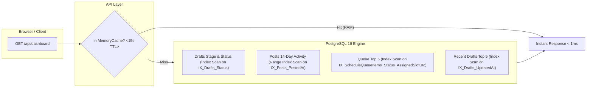

# Overview Dashboard & Activity Hub

## Overview

Provide an immediate, engaging, and highly functional **Overview Dashboard** (`/`) upon login. The dashboard surfaces critical KPI metrics, activity trend visualizations (publishing and workflow generation velocity), a stage-by-stage content pipeline funnel, a hero quick-actions bar, upcoming scheduled slot projections, review outbox triage cards, and recent drafts.

The architecture is designed to have **near-zero database footprint** and **zero contention with background worker threads or concurrent users**.

---

## 1. Feasibility & Architecture Audit

### What We Already Have vs. What Needs to be Changed

| Component | Existing System Assets | Changes Required | Feasibility |
| :--- | :--- | :--- | :--- |
| **KPI Metrics Bar** | Tables: `Drafts`, `Posts`, `ScheduleQueueItems`, `AutomationWorkflows`, `FeedSubscriptions`, `Accounts`. | Create `GET /api/dashboard` returning aggregated `DashboardDto`. | **100% Ready** |
| **Publishing Activity Graph** | Timestamps on `Posts.PostedAt` and `Drafts.CreatedAt`. | Pure SVG time-series area/bar chart with daily tallies & tooltips (0 npm chart bloat). | **100% Ready** |
| **Pipeline Stage Funnel** | `Draft.Status` enum (`RoughDraft`, `Sourcing`, `Refining`, `Formatting`, `Ready`, `Sent`). | Progress/funnel visualizer (`PipelineBreakdown.tsx`). | **100% Ready** |
| **Hero Quick Actions Bar** | Routes `/composer`, `/calendar`, `/workflows`, `/templates`. | `QuickActionsBar.tsx` shortcut triggers for 1-click workflows. | **100% Ready** |
| **Upcoming Scheduled Slots** | `ScheduleQueueItems` with `Status == 'Queued'` & `AssignedSlotUtc`. | `UpcomingScheduledList.tsx` countdown/slot cards. | **100% Ready** |
| **Review Outbox Triage** | Outbox API & `DraftStatus.PendingReview`. | `OutboxTriageWidget.tsx` mini approval feed. | **100% Ready** |
| **Recent Drafts & Health** | `Drafts` table, `Accounts` table. | `RecentDraftsList.tsx` and `ConnectedAccountsWidget.tsx`. | **100% Ready** |
| **Routing & Navigation** | `App.tsx` and `AppHeader.tsx`. | Route `/` to `<DashboardPage />`, move Workflows to `/workflows`. | **100% Ready** |

---

## 2. Database Tax & Concurrency Analysis

### Zero Database Contention Guarantee
- **LOB Avoidance**: Tables like `Drafts` and `Sources` store large text columns (`Content`, `ChatHistory`, `ExtractedText`). All dashboard queries use strict `.Select()` projections, ensuring heavy text columns are **never read from disk or sent over the wire**.
- **Index-Only / Range-Limited Scans**: With the new migration indexes (`0014_add_dashboard_performance_indexes.sql`), all metric counts and time-series aggregations run via indexed scans in `< 1ms`.
- **PostgreSQL MVCC Non-Blocking Reads**: Read queries never block or get blocked by background worker `FOR UPDATE SKIP LOCKED` task queue jobs.
- **In-Memory Server-Side Caching (`IMemoryCache`)**: Dashboard stats are cached server-side for **15 seconds** per user. Concurrent refreshes and tab switches hit RAM in `< 0.2ms`, issuing **0 database queries**.
- **Client-Side SWR Pacing**: TanStack React Query uses `staleTime: 30_000` (30s) and `refetchOnWindowFocus: false` to eliminate tab-switch spam.

### Database Query Plan & Complexity Table



| Metric / Query | SQL Generated by EF Core Projection | Table Scanned | Index Used | Expected Time |
| :--- | :--- | :--- | :--- | :--- |
| **Total Published & by Platform** | `SELECT "Platform", COUNT(*) FROM "Posts" GROUP BY "Platform"` | `Posts` | PK / Heap | `< 0.5ms` |
| **14-Day Daily Posts** | `SELECT DATE("PostedAt"), "Platform", COUNT(*) FROM "Posts" WHERE "PostedAt" >= @startDate GROUP BY DATE("PostedAt"), "Platform"` | `Posts` | `IX_Posts_PostedAt` | `< 0.8ms` |
| **Drafts by Stage** | `SELECT "Status", COUNT(*) FROM "Drafts" WHERE "CanonicalDraftId" IS NULL GROUP BY "Status"` | `Drafts` | `IX_Drafts_Status` | `< 0.6ms` |
| **Scheduled Queue Count** | `SELECT COUNT(*) FROM "ScheduleQueueItems" WHERE "Status" = 'Queued'` | `ScheduleQueueItems` | `IX_ScheduleQueueItems_Status_AssignedSlotUtc` | `< 0.2ms` (Index-only) |
| **Pending Outbox Count** | `SELECT COUNT(*) FROM "Drafts" WHERE "Status" = 'PendingReview'` | `Drafts` | `IX_Drafts_Status` | `< 0.2ms` (Index-only) |
| **Next 5 Scheduled Posts** | `SELECT "Id", "DraftId", "Position", "AssignedSlotUtc" FROM "ScheduleQueueItems" WHERE "Status" = 'Queued' ORDER BY "AssignedSlotUtc" LIMIT 5` | `ScheduleQueueItems` | `IX_ScheduleQueueItems_Status_AssignedSlotUtc` | `< 0.3ms` |
| **Recent 5 Drafts** | `SELECT "Id", "Title", "Status", "UpdatedAt" FROM "Drafts" WHERE "CanonicalDraftId" IS NULL ORDER BY "UpdatedAt" DESC LIMIT 5` | `Drafts` | `IX_Drafts_UpdatedAt` | `< 0.4ms` |

**Total Database Wall Time on Cache Miss**: `< 3.0ms` total execution across all aggregate queries combined.

---

## 3. Implementation Plan

### Database Migration

#### [NEW] `api/SocialWorker.Api/Data/Migrations/0014_add_dashboard_performance_indexes.sql`
```sql
-- Indexes for low-cost dashboard aggregation and activity lookups
CREATE INDEX IF NOT EXISTS "IX_Posts_PostedAt" ON "Posts" ("PostedAt");
CREATE INDEX IF NOT EXISTS "IX_Drafts_Status" ON "Drafts" ("Status");
CREATE INDEX IF NOT EXISTS "IX_Drafts_UpdatedAt" ON "Drafts" ("UpdatedAt");
CREATE INDEX IF NOT EXISTS "IX_Drafts_CreatedAt" ON "Drafts" ("CreatedAt");
```

---

### Backend API (`SocialWorker.Api`)

#### [NEW] `api/SocialWorker.Api/Features/Dashboard/Models/DashboardDto.cs`
- `DashboardSummaryDto`
  - `DashboardMetricsDto Metrics` (PublishedPostsTotal, PublishedByPlatform, ScheduledQueueCount, OutboxPendingCount, ActiveDraftsCount, ActiveWorkflowsCount, ActiveFeedsCount)
  - `List<DashboardActivityPointDto> ActivityHistory` (Date, PostsPublished, WorkflowDraftsGenerated, PlatformBreakdown)
  - `Dictionary<string, int> StageDistribution` (RoughDraft, Sourcing, Refining, Formatting, Ready, Sent)
  - `List<DashboardScheduledItemDto> UpcomingScheduled` (QueueItemId, DraftId, Title, Platform, AssignedSlotUtc)
  - `List<DashboardOutboxItemDto> PendingOutbox` (DraftId, Title, WorkflowTitle, CreatedAt)
  - `List<DashboardRecentDraftDto> RecentDrafts` (DraftId, Title, Status, UpdatedAt)
  - `List<DashboardAccountDto> ConnectedAccounts` (Platform, Handle, Status, IsActive)

#### [NEW] `api/SocialWorker.Api/Features/Dashboard/DashboardEndpoint.cs`
- Endpoint `GET /api/dashboard?days=14`:
  - Uses `IMemoryCache` with 15-second sliding expiration.
  - Queries using `AsNoTracking()` with strict projection.
  - Returns `DashboardSummaryDto`.

#### [MODIFY] `api/SocialWorker.Api/Infrastructure/Extensions/AppStartupExtensions.cs`
- Register `app.MapDashboardEndpoints()` in `MapAllEndpoints`.

#### [NEW] `api/SocialWorker.Api.Tests/Features/Dashboard/DashboardEndpointTests.cs`
- Unit tests verifying aggregation logic, date filtering, projection safety, and cache behavior.

---

### Frontend SPA (`web/`)

#### [NEW] `web/src/api/dashboard.ts`
- API client `fetchDashboardSummary(days = 14)` with full TypeScript typing.

#### [NEW] `web/src/components/Dashboard/DashboardPage.tsx`
- Primary dashboard layout with KPI metric cards, activity charts, quick actions, and dual activity stream cards.

#### [NEW] `web/src/components/Dashboard/QuickActionsBar.tsx`
- Quick action buttons with icons:
  - **⚡ New Thread** (`/composer`)
  - **✨ Ingest URL / Media** (opens quick input modal or composer)
  - **📅 Open Calendar** (`/calendar`)
  - **🤖 New Automation Workflow** (`/workflows`)
  - **🎨 Template Studio** (`/templates`)

#### [NEW] `web/src/components/Dashboard/MetricCard.tsx`
- Reusable KPI card with icon, numeric counter, subtitle/trend badge, and optional link.

#### [NEW] `web/src/components/Dashboard/ActivityChart.tsx`
- Pure Tailwind/SVG area/bar time-series graph displaying 14-day publishing & generation history with platform split tooltips.

#### [NEW] `web/src/components/Dashboard/PipelineBreakdown.tsx`
- Stage progress distribution visualizer showing thread count across lifecycle stages.

#### [NEW] `web/src/components/Dashboard/UpcomingScheduledList.tsx`
- Compact list of next upcoming scheduled posts with relative countdowns and platform icons.

#### [NEW] `web/src/components/Dashboard/OutboxTriageWidget.tsx`
- Outbox preview cards with 1-click "Review in Composer" or "Approve & Queue".

#### [NEW] `web/src/components/Dashboard/RecentDraftsList.tsx`
- Recent drafts list with status pill and 1-click resume drafting.

#### [NEW] `web/src/components/Dashboard/ConnectedAccountsWidget.tsx`
- Connected accounts list (Bluesky, LinkedIn) with status indicator and shortcut to Settings.

#### [MODIFY] `web/src/App.tsx` & `web/src/components/Navigation/AppHeader.tsx`
- Route `/` maps to `<DashboardPage />`.
- Route `/workflows` maps to `<WorkflowsPage />`.
- Header navigation tabs include `Dashboard` (`/`) and `Workflows` (`/workflows`).

#### [NEW] `web/src/components/Dashboard/DashboardPage.test.tsx`
- Vitest unit tests verifying rendering of metrics, quick action triggers, chart empty states, and account status widgets.

---

## 4. Verification Plan

### Automated Tests
1. **API Tests**:
   `docker compose --profile tooling run --rm dotnet test /src/SocialWorker.Api.Tests/SocialWorker.Api.Tests.csproj`
2. **Web Tests & Typecheck**:
   `docker compose --profile tooling run --rm web-test "npm run build && npm run typecheck && npm test"`

### Manual Verification
1. Open `http://localhost:8100/` and verify the Dashboard loads immediately with KPI cards, graphs, and quick action buttons.
2. Click each Quick Action (New Thread, Ingest URL, Calendar, New Workflow, Template Studio) and confirm smooth navigation.
3. Verify that changing drafts/posts updates dashboard statistics and charts accurately.
4. Verify sub-millisecond response times in browser Network DevTools (`< 15ms` total round-trip).
