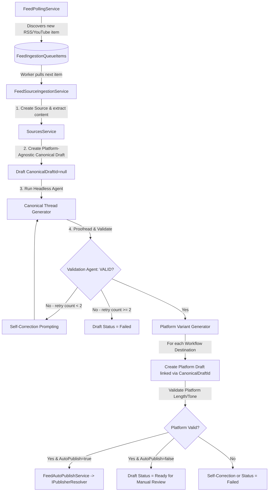

# Decoupled Multi-Source & Multi-Destination Automation Workflows

## Goal Description
Currently, feed ingestion and thread orchestration are coupled in the `FeedSubscription` entity (a single feed URL has hardcoded instructions, a single auto-publish flag, and hardcoded Bluesky dispatch).

This plan outlines the design and implementation to decouple feed ingestion from orchestration:
1. **`AutomationWorkflow`** becomes a first-class orchestration entity managing custom prompt instructions and multiple platform destinations (with per-destination auto-publish flags).
2. **Many-to-Many Sources**: Workflows can subscribe to multiple RSS/YouTube feed sources via `AutomationWorkflowSource`.
3. **Test-First TDD**: Full unit test coverage mapped and implemented before/alongside each service refactor.
4. **Sequential 2-Tier Generation**: Ingest source -> Generate canonical draft -> Validate canonical draft (self-correcting) -> Generate platform-specific variant drafts -> Validate platform drafts -> Multi-platform auto-publish.
5. **Frontend Surface**: Sync API contracts with the web Workflows Dashboard and Logs views.

---

## 1. Test-First Implementation Strategy (TDD)

Per `AGENTS.md` guidelines, new services, refactors, and endpoints must be covered by xUnit tests under `SocialWorker.Api.Tests/`.

### A. Test Infrastructure Updates
- **[`TestServiceFactory.cs`](file:///home/vhogemann/Projects/social-worker/api/SocialWorker.Api.Tests/TestServiceFactory.cs)**:
  - Add factory helpers to seed `AutomationWorkflow`, `AutomationWorkflowSource`, `AutomationWorkflowDestination`, and mock publisher instances.
- **[`SqliteTestBase.cs`](file:///home/vhogemann/Projects/social-worker/api/SocialWorker.Api.Tests/SqliteTestBase.cs)**:
  - Supports new entity relationships in in-memory SQLite automatically.

### B. Mandatory Unit Test Matrix (To write before/during feature implementation)

| Test Suite File | Responsibility & Test Scenarios |
|---|---|
| **`AutomationWorkflowTests.cs`** (NEW) | - `AutomationWorkflow.Create` invariant checks (title required, prompt fallback).<br>- `AutomationWorkflowDestination.Create` platform validation.<br>- Workflows REST API CRUD endpoints (GET, POST, PUT, DELETE, trigger).<br>- Validation rules for `CreateAutomationWorkflowRequest`. |
| **`FeedPollingServiceTests.cs`** (NEW) | - Feed polled with 0 linked workflows -> no queue items created.<br>- Feed polled with 2 linked workflows -> creates 2 distinct queue items scoped to each workflow.<br>- Deduplication: does not re-queue existing `(FeedSubscriptionId, AutomationWorkflowId, ItemLink)` tuples.<br>- Updates `LastPolledAt` on subscription. |
| **`FeedOrchestrationServiceTests.cs`** (NEW) | - Orchestrator loads workflow and starts canonical draft generation.<br>- Ingestion failure marks queue item / draft as failed.<br>- Successful canonical validation triggers variant creation for all workflow destinations.<br>- Validation rejection triggers self-correction retry loop (up to 2 attempts).<br>- Exhausted retries flags draft as `Failed` without auto-publishing. |
| **`FeedAutoPublishServiceTests.cs`** (NEW) | - Dynamic dispatch to `BlueskyPublisher`, `LinkedInPublisher` via `IPublisherResolver`.<br>- Ignores destinations where `AutoPublish = false`.<br>- Handles single platform failure gracefully without aborting other destinations. |
| **`FluentValidationTests.cs`** (UPDATE) | - Update `CreateFeedSubscriptionRequestValidator` tests to verify simplified feed contract.<br>- Add tests for `CreateAutomationWorkflowRequestValidator`. |

---

## 2. Database Schema & Migration (`0006_add_automation_workflows.sql`)

Because the database is in pre-production, existing feed queue data and decoupled subscription columns can be safely dropped and recreated.

### Raw SQL Migration Script: `api/SocialWorker.Api/Data/Migrations/0006_add_automation_workflows.sql`

```sql
-- 1. Create AutomationWorkflows table
CREATE TABLE IF NOT EXISTS "AutomationWorkflows" (
    "Id" uuid NOT NULL,
    "UserId" uuid NOT NULL,
    "Title" character varying(200) NOT NULL,
    "InstructionPrompt" text NOT NULL,
    "CreatedAt" timestamp with time zone NOT NULL,
    "UpdatedAt" timestamp with time zone NOT NULL,
    CONSTRAINT "PK_AutomationWorkflows" PRIMARY KEY ("Id"),
    CONSTRAINT "FK_AutomationWorkflows_Users_UserId" FOREIGN KEY ("UserId") REFERENCES "Users" ("Id") ON DELETE CASCADE
);

CREATE INDEX IF NOT EXISTS "IX_AutomationWorkflows_UserId" ON "AutomationWorkflows" ("UserId");

-- 2. Create AutomationWorkflowSources join table (Many-to-Many)
CREATE TABLE IF NOT EXISTS "AutomationWorkflowSources" (
    "AutomationWorkflowId" uuid NOT NULL,
    "FeedSubscriptionId" uuid NOT NULL,
    CONSTRAINT "PK_AutomationWorkflowSources" PRIMARY KEY ("AutomationWorkflowId", "FeedSubscriptionId"),
    CONSTRAINT "FK_AutomationWorkflowSources_AutomationWorkflows_AutomationWorkflowId" 
        FOREIGN KEY ("AutomationWorkflowId") REFERENCES "AutomationWorkflows" ("Id") ON DELETE CASCADE,
    CONSTRAINT "FK_AutomationWorkflowSources_FeedSubscriptions_FeedSubscriptionId" 
        FOREIGN KEY ("FeedSubscriptionId") REFERENCES "FeedSubscriptions" ("Id") ON DELETE CASCADE
);

CREATE INDEX IF NOT EXISTS "IX_AutomationWorkflowSources_FeedSubscriptionId" ON "AutomationWorkflowSources" ("FeedSubscriptionId");

-- 3. Create AutomationWorkflowDestinations table
CREATE TABLE IF NOT EXISTS "AutomationWorkflowDestinations" (
    "Id" uuid NOT NULL,
    "AutomationWorkflowId" uuid NOT NULL,
    "Platform" character varying(50) NOT NULL,
    "AutoPublish" boolean NOT NULL DEFAULT FALSE,
    CONSTRAINT "PK_AutomationWorkflowDestinations" PRIMARY KEY ("Id"),
    CONSTRAINT "FK_AutomationWorkflowDestinations_AutomationWorkflows_AutomationWorkflowId" 
        FOREIGN KEY ("AutomationWorkflowId") REFERENCES "AutomationWorkflows" ("Id") ON DELETE CASCADE
);

CREATE INDEX IF NOT EXISTS "IX_AutomationWorkflowDestinations_AutomationWorkflowId" ON "AutomationWorkflowDestinations" ("AutomationWorkflowId");

-- 4. Alter Drafts table: link provenance to workflow
ALTER TABLE "Drafts" ADD COLUMN IF NOT EXISTS "AutomationWorkflowId" uuid NULL;
ALTER TABLE "Drafts" ADD CONSTRAINT "FK_Drafts_AutomationWorkflows_AutomationWorkflowId" 
    FOREIGN KEY ("AutomationWorkflowId") REFERENCES "AutomationWorkflows" ("Id") ON DELETE SET NULL;
CREATE INDEX IF NOT EXISTS "IX_Drafts_AutomationWorkflowId" ON "Drafts" ("AutomationWorkflowId");

-- 5. Drop old queue items and recreate schema with AutomationWorkflowId
DROP TABLE IF EXISTS "FeedIngestionQueueItems";
CREATE TABLE "FeedIngestionQueueItems" (
    "Id" uuid NOT NULL,
    "FeedSubscriptionId" uuid NOT NULL,
    "AutomationWorkflowId" uuid NOT NULL,
    "ItemTitle" character varying(500) NOT NULL,
    "ItemLink" character varying(1000) NOT NULL,
    "ItemDescription" text NULL,
    "ItemPublishedAt" timestamp with time zone NULL,
    "Status" character varying(50) NOT NULL,
    "AttemptCount" integer NOT NULL DEFAULT 0,
    "MaxAttempts" integer NOT NULL DEFAULT 3,
    "NextAttemptAt" timestamp with time zone NOT NULL,
    "LastAttemptAt" timestamp with time zone NULL,
    "LastError" text NULL,
    "CreatedAt" timestamp with time zone NOT NULL,
    "UpdatedAt" timestamp with time zone NOT NULL,
    "CompletedAt" timestamp with time zone NULL,
    CONSTRAINT "PK_FeedIngestionQueueItems" PRIMARY KEY ("Id"),
    CONSTRAINT "FK_FeedIngestionQueueItems_FeedSubscriptions_FeedSubscriptionId" 
        FOREIGN KEY ("FeedSubscriptionId") REFERENCES "FeedSubscriptions" ("Id") ON DELETE CASCADE,
    CONSTRAINT "FK_FeedIngestionQueueItems_AutomationWorkflows_AutomationWorkflowId" 
        FOREIGN KEY ("AutomationWorkflowId") REFERENCES "AutomationWorkflows" ("Id") ON DELETE CASCADE
);

CREATE INDEX IF NOT EXISTS "IX_FeedIngestionQueueItems_FeedSubscriptionId" ON "FeedIngestionQueueItems" ("FeedSubscriptionId");
CREATE INDEX IF NOT EXISTS "IX_FeedIngestionQueueItems_AutomationWorkflowId" ON "FeedIngestionQueueItems" ("AutomationWorkflowId");
CREATE UNIQUE INDEX IF NOT EXISTS "IX_FeedIngestionQueueItems_Sub_Workflow_Link" 
    ON "FeedIngestionQueueItems" ("FeedSubscriptionId", "AutomationWorkflowId", "ItemLink");
CREATE INDEX IF NOT EXISTS "IX_FeedIngestionQueueItems_Status_NextAttemptAt" 
    ON "FeedIngestionQueueItems" ("Status", "NextAttemptAt");

-- 6. Simplify FeedSubscriptions by dropping decoupled fields
ALTER TABLE "FeedSubscriptions" DROP COLUMN IF EXISTS "InstructionPrompt";
ALTER TABLE "FeedSubscriptions" DROP COLUMN IF EXISTS "AutoPublish";
```

---

## 3. Domain Entities & EF Core Model

### A. [`AutomationWorkflow.cs`](file:///home/vhogemann/Projects/social-worker/api/SocialWorker.Api/Data/Entities/AutomationWorkflow.cs) (NEW)
```csharp
namespace SocialWorker.Api.Data.Entities;

public class AutomationWorkflow
{
    public Guid Id { get; set; }
    public Guid UserId { get; set; }
    public AppUser User { get; set; } = null!;
    public string Title { get; set; } = null!;
    public string InstructionPrompt { get; set; } = null!;
    public ICollection<AutomationWorkflowSource> WorkflowSources { get; set; } = new List<AutomationWorkflowSource>();
    public ICollection<AutomationWorkflowDestination> Destinations { get; set; } = new List<AutomationWorkflowDestination>();
    public DateTime CreatedAt { get; set; } = DateTime.UtcNow;
    public DateTime UpdatedAt { get; set; } = DateTime.UtcNow;

    public static AutomationWorkflow Create(Guid userId, string title, string instructionPrompt)
    {
        if (string.IsNullOrWhiteSpace(title))
            throw new ArgumentException("Title is required.", nameof(title));

        return new AutomationWorkflow
        {
            Id = Guid.NewGuid(),
            UserId = userId,
            Title = title.Trim(),
            InstructionPrompt = string.IsNullOrWhiteSpace(instructionPrompt) 
                ? "Summarize this article as a thread." 
                : instructionPrompt.Trim(),
            CreatedAt = DateTime.UtcNow,
            UpdatedAt = DateTime.UtcNow
        };
    }
}
```

### B. [`AutomationWorkflowSource.cs`](file:///home/vhogemann/Projects/social-worker/api/SocialWorker.Api/Data/Entities/AutomationWorkflowSource.cs) (NEW)
```csharp
namespace SocialWorker.Api.Data.Entities;

public class AutomationWorkflowSource
{
    public Guid AutomationWorkflowId { get; set; }
    public AutomationWorkflow AutomationWorkflow { get; set; } = null!;
    public Guid FeedSubscriptionId { get; set; }
    public FeedSubscription FeedSubscription { get; set; } = null!;
}
```

### C. [`AutomationWorkflowDestination.cs`](file:///home/vhogemann/Projects/social-worker/api/SocialWorker.Api/Data/Entities/AutomationWorkflowDestination.cs) (NEW)
```csharp
namespace SocialWorker.Api.Data.Entities;

public class AutomationWorkflowDestination
{
    public Guid Id { get; set; }
    public Guid AutomationWorkflowId { get; set; }
    public AutomationWorkflow AutomationWorkflow { get; set; } = null!;
    public string Platform { get; set; } = null!; // e.g. "Bluesky", "LinkedIn"
    public bool AutoPublish { get; set; }

    public static AutomationWorkflowDestination Create(string platform, bool autoPublish)
    {
        if (string.IsNullOrWhiteSpace(platform))
            throw new ArgumentException("Platform is required.", nameof(platform));

        return new AutomationWorkflowDestination
        {
            Id = Guid.NewGuid(),
            Platform = platform.Trim(),
            AutoPublish = autoPublish
        };
    }
}
```

---

## 4. REST API Surface Specification

### A. Workflows Endpoints (`/api/workflows`)

Defined in [`WorkflowsEndpoint.cs`](file:///home/vhogemann/Projects/social-worker/api/SocialWorker.Api/Features/Workflows/WorkflowsEndpoint.cs):

| Method | Path | Auth | Description |
|---|---|---|---|
| `GET` | `/api/workflows` | Bearer | List all workflows owned by user (includes sources & destinations) |
| `POST` | `/api/workflows` | Bearer | Create a new workflow |
| `GET` | `/api/workflows/{id:guid}` | Bearer | Get workflow details by ID |
| `PUT` | `/api/workflows/{id:guid}` | Bearer | Update workflow title, prompt, sources, and destinations |
| `DELETE` | `/api/workflows/{id:guid}` | Bearer | Delete workflow and cascade associations |
| `POST` | `/api/workflows/{id:guid}/trigger` | Bearer | Trigger immediate run of this workflow across its feeds |

#### Request & Response Models (C# & TypeScript parity):

```csharp
public sealed record WorkflowDestinationDto(Guid Id, string Platform, bool AutoPublish);
public sealed record WorkflowSourceDto(Guid FeedSubscriptionId, string Title, string FeedUrl);

public sealed record AutomationWorkflowDto(
    Guid Id,
    string Title,
    string InstructionPrompt,
    List<WorkflowSourceDto> Sources,
    List<WorkflowDestinationDto> Destinations,
    DateTime CreatedAt,
    DateTime UpdatedAt);

public sealed record CreateWorkflowDestinationRequest(string Platform, bool AutoPublish);

public sealed record CreateAutomationWorkflowRequest(
    string Title,
    string InstructionPrompt,
    List<Guid> FeedSubscriptionIds,
    List<CreateWorkflowDestinationRequest> Destinations);
```

### B. Updated Feeds Endpoints (`/api/feeds`)

- `POST /api/feeds` and `PUT /api/feeds/{id}` request contracts simplified to:
  ```csharp
  public sealed record CreateFeedSubscriptionRequest(
      string Title,
      string FeedUrl,
      string? WebsiteUrl,
      string? IncludeFilters,
      string? ExcludeFilters);
  ```
- `FeedSubscriptionDto` removes `InstructionPrompt` and `AutoPublish`.
- `FeedQueueItemDto` updated to include `AutomationWorkflowId` and `AutomationWorkflowTitle`:
  ```csharp
  public sealed record FeedQueueItemDto(
      Guid Id,
      Guid FeedSubscriptionId,
      string FeedSubscriptionTitle,
      Guid AutomationWorkflowId,
      string AutomationWorkflowTitle,
      string ItemTitle,
      string ItemLink,
      string Status,
      int AttemptCount,
      int MaxAttempts,
      DateTime NextAttemptAt,
      string? LastError,
      DateTime CreatedAt,
      DateTime UpdatedAt,
      DateTime? CompletedAt);
  ```

---

## 5. Orchestration Pipeline & Agent Flow



### Specialized Agent Prompts:
1. **Headless Generation Mode**: Injected context prompt instructing the LLM to call `replace_editor_content` directly without pleasantries.
2. **Proofreader Validation Prompt**: Stateless LLM call checking fact retention, prompt constraints, and platform limits, returning `VALID` or `REJECT: <reasons>`.

---

## 6. Implementation Phasing

### Phase 1: Test Infrastructure, Entities & SQL Migration
1. Create SQL migration `0006_add_automation_workflows.sql`.
2. Add domain entities `AutomationWorkflow`, `AutomationWorkflowSource`, `AutomationWorkflowDestination`.
3. Update `FeedSubscription`, `Draft`, and `FeedIngestionQueueItem` entity classes.
4. Update `AppDbContext` entity mappings and relations.
5. Add `AutomationWorkflowTests.cs` verifying database mapping and static factory methods.

### Phase 2: Workflows REST Endpoints, DTOs & Validators
1. Implement `WorkflowsEndpoint.cs` (`/api/workflows`) with full CRUD and trigger.
2. Implement FluentValidation validators for workflow requests.
3. Update `FeedsEndpoint.cs` and `FeedValidators.cs` to remove old prompt/publish properties.
4. Update `FluentValidationTests.cs` and add endpoint integration tests.

### Phase 3: Decoupled Polling & Ingestion
1. Update `FeedPollingService.cs` to query linked workflows and insert queue items with `AutomationWorkflowId`.
2. Update `FeedSourceIngestionService.cs` to create platform-agnostic canonical drafts instead of hardcoded Bluesky drafts.
3. Add `FeedPollingServiceTests.cs` covering 0, 1, and N workflow associations and deduplication.

### Phase 4: Sequential Orchestration, Validation Agent & Auto-Publish
1. Implement `FeedThreadGenerationService` enhancements for canonical draft generation + platform variants generation.
2. Implement `DraftValidationService` for automated proofreading and self-correction retry loop.
3. Refactor `FeedAutoPublishService` to use dynamic `IPublisherResolver` for all active destinations.
4. Add `FeedOrchestrationServiceTests` and `FeedAutoPublishServiceTests`.

### Phase 5: Web Frontend Contract Sync & Dashboard
1. Update `web/src/api/feeds.ts` and create `web/src/api/workflows.ts`.
2. Implement `WorkflowsPanel` on the frontend and shift default route `/` to the dashboard.
3. Move queue backlog to the dedicated `Logs` page.
