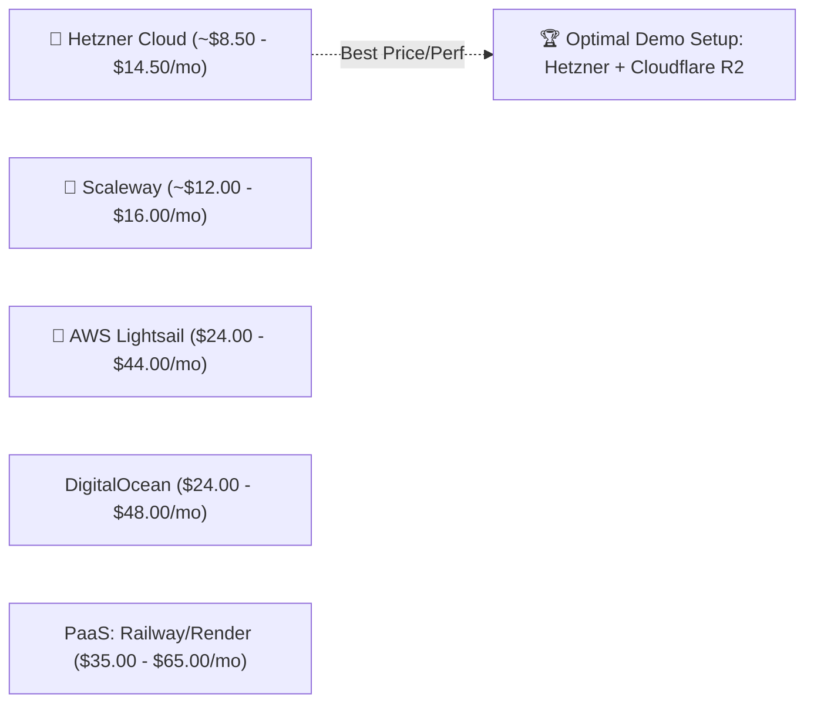
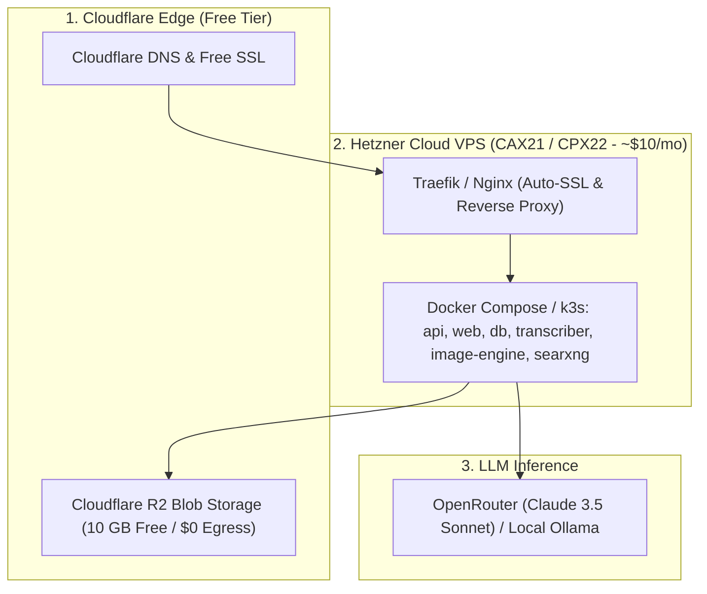

# Cloud Provider Cost & Feasibility Research for Initial Demo Deployment

This research evaluates the most cost-effective hosting providers and compute architectures for running an initial **live demo / staging deployment** of SocialWorker.

---

## 1. SocialWorker Workload Sizing Profile

To run the complete SocialWorker stack smoothly, we analyze the compute footprint of its containerized services:

| Service | Technology | Idle RAM | Peak RAM (Active Workflow/Transcription) | CPU Profile |
| :--- | :--- | :--- | :--- | :--- |
| **`api`** | ASP.NET Core .NET 10 | 120 MB | 250 MB | Low / Burst during publishing |
| **`web`** | Nginx + React SPA | 15 MB | 30 MB | Negligible |
| **`db`** | PostgreSQL 16 | 90 MB | 250 MB | Low |
| **`searxng`** | Python / Uvicorn | 80 MB | 150 MB | Burst during web search |
| **`image-engine`** | Node.js 22 + Sharp/Canvas | 90 MB | 200 MB | Burst during banner/template render |
| **`transcriber`** | FastAPI + Whisper (base/small) | 350 MB | 1,200 MB | High during audio transcription (CPU) |
| **TOTAL STACK** | **6 Containers** | **~750 MB** | **~2.1 GB – 3.2 GB** | **2–4 vCPUs Recommended** |

> [!IMPORTANT]
> **Recommended Minimum Hardware**: **4 vCPU / 8 GB RAM / 50+ GB NVMe SSD**.  
> While the stack *can* boot on 4 GB RAM, having **8 GB RAM** ensures Whisper audio transcription and image rendering never trigger out-of-memory (OOM) killer events when running concurrently with PostgreSQL.

---

## 2. Cloud Provider Pricing & Benchmark Comparison

### Comprehensive Provider Matrix (8 GB RAM Tier)

| Provider & Plan | Architecture & Specs | Included Egress Bandwidth | Monthly Cost (USD) | Relative Cost Index | Verdict / Notes |
| :--- | :--- | :--- | :--- | :--- | :--- |
| **🥇 1. Hetzner Cloud (CAX21 / CPX22)** | **4 vCPU (Ampere ARM / AMD), 8 GB RAM, 80–160 GB NVMe** | **20 TB / mo** (Free) | **~$8.50 – $14.50 / mo** | **1.0x (Baseline)** | 🏆 **Clear Winner**. 60–70% cheaper than AWS/DigitalOcean with fast NVMe I/O and generous bandwidth. Available in EU & US (Ashburn, VA / Hillsboro, OR). |
| **🥈 2. Scaleway (DEV1-L / AMP2)** | **4 vCPU, 8 GB RAM, 50 GB NVMe** | **Free Egress** (Fair use) | **~$12.00 – $16.00 / mo** | **1.2x** | Excellent European privacy alternative with full GDPR compliance. |
| **🥉 3. AWS Lightsail (8GB Bundle)** | **2 vCPU, 8 GB RAM, 160 GB SSD** | **5 TB / mo** | **$44.00 / mo** | **3.5x** | Predictable bundled AWS pricing, but significantly higher cost for half the vCPU cores. |
| **4. DigitalOcean (Basic Droplet)** | **4 vCPU, 8 GB RAM, 160 GB SSD** | **5 TB / mo** | **$48.00 / mo** | **3.8x** | Great UI and documentation, but high pricing for standard compute. |
| **5. Linode / Akamai** | **4 vCPU, 8 GB RAM, 160 GB SSD** | **4 TB / mo** | **$48.00 / mo** | **3.8x** | Parity with DigitalOcean pricing. |
| **6. PaaS (Railway / Render)** | **6 Separate Service Containers (Per-GB/hr)** | Varies | **~$35.00 – $65.00 / mo** | **4.5x** | Very expensive for multi-container stacks running continuous database + Whisper workloads. |

---

## 3. Recommended Architecture: The $15/Month Demo Blueprint

The most cost-effective and production-capable architecture for an initial live demo deployment:

### Bill of Materials (BOM):

| Component | Provider & Specification | Monthly Cost | Notes |
| :--- | :--- | :--- | :--- |
| **Compute Server** | Hetzner Cloud **CAX21** (4 vCPU ARM, 8 GB RAM, 80 GB NVMe) | **~$8.50 / mo** (€7.90) | Runs all 6 Docker containers simultaneously |
| **Blob Storage** | Cloudflare R2 (10 GB storage, 1M Class A, 10M Class B ops) | **$0.00 / mo** | $0 bandwidth egress fees for media assets & carousels |
| **DNS & SSL** | Cloudflare Free Plan + Let's Encrypt | **$0.00 / mo** | Global CDN caching + DDoS protection |
| **LLM Inference** | OpenRouter (Pay-as-you-go token API) | **~$5.00 – $10.00 / mo** | ~1M–2M tokens (dozens of full multi-platform threads) |
| **Whisper Audio** | Local Whisper on Hetzner Server | **$0.00 / mo** | Run locally with zero external API fees |
| **Private Search** | Local SearXNG on Hetzner Server | **$0.00 / mo** | Run locally with zero external API fees |
| **TOTAL DEMO COST** | | **~$13.50 – $18.50 / mo** | **Ultra-lean, high-performance demo deployment** |

---

## 4. Deployment Strategy Options

1. **Option A: Docker Compose with Automated Traefik (Simplest & Fastest)**:
   - Provision Hetzner VPS with Ubuntu 24.04 LTS.
   - Run our existing `scripts/redeploy.sh`.
   - Traefik automatically generates Let's Encrypt SSL certificates for your domain (e.g. `demo.socialworker.app`).
   - Time to live: **~10 minutes**.

2. **Option B: Lightweight Kubernetes (k3s) on Hetzner**:
   - Install single-node `k3s` on the Hetzner VPS (`curl -sfL https://get.k3s.io | sh -`).
   - Apply our `k8s/base` manifests.
   - Provides a direct stepping stone to multi-node production clusters without paying managed control-plane fees.

---

## 5. Summary Recommendation

- **Winner**: **Hetzner Cloud (CAX21 / CPX22)** combined with **Cloudflare R2**.
- **Total Cost**: **Under $20/month** for a full-featured, high-speed, live multi-modal demo.
- **Next Step**: Deploy using Docker Compose + Traefik for immediate demo readiness, or spin up single-node `k3s` using our new Kubernetes manifests.
