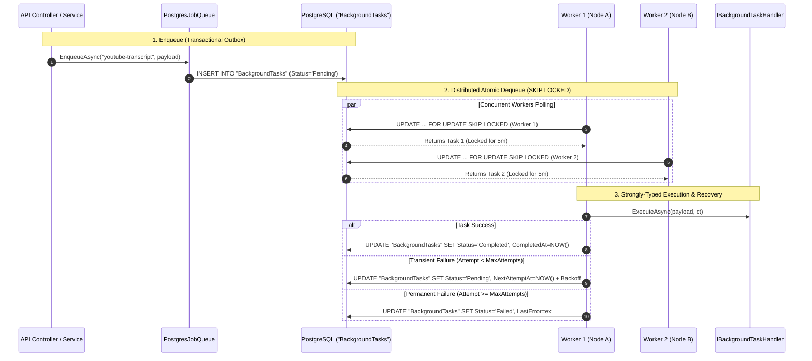

# Durable PostgreSQL `SKIP LOCKED` Task Queue Plan

## Overview
This plan establishes a **durable, transactional, distributed task queue** backed by PostgreSQL 16 `FOR UPDATE SKIP LOCKED`, replacing the in-memory `System.Threading.Channels` queue.

---

## Architectural Highlights



---

## Core Components

1. **Entity**: `BackgroundTask.cs` stored in table `"BackgroundTasks"`.
2. **Queue Interface**: `IBackgroundTaskQueue` supporting typed enqueueing and atomic `FOR UPDATE SKIP LOCKED` dequeueing.
3. **Worker Pool**: `BackgroundJobHostedService` running `N` parallel workers (default 4) with graceful backoff and crash lease recovery.
4. **Typed Handlers**:
   - `YouTubeTranscriptTaskHandler`
   - `FeedIngestionTaskHandler`
   - `ChatSummaryTaskHandler`
   - `TemplateRenderTaskHandler`

---

## Verification Plan

1. **Unit & Integration Tests**:
   - `PostgresBackgroundTaskQueueTests.cs` testing concurrent dequeueing without race conditions.
   - Retry with exponential backoff and dead-lettering tests.
   - Lease expiration and automatic crash recovery tests.
2. **Execution**:
   ```bash
   docker compose --profile tooling run --rm dotnet test ../SocialWorker.Api.Tests/SocialWorker.Api.Tests.csproj
   ```
