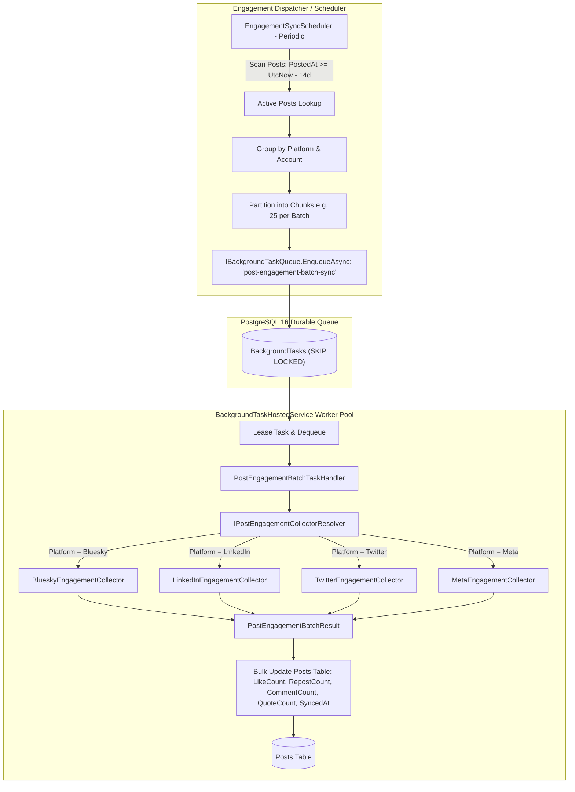

# Unified Multi-Platform Post Engagement Sync Queue

## Overview

A unified, multi-platform background synchronization engine that periodically captures live engagement metrics (**likes, reposts/shares, replies/comments, quotes**) across target publishing platforms (Bluesky, LinkedIn, Twitter, Meta/FB/IG) using SocialWorker's existing durable PostgreSQL task queue (`BackgroundTasks`).

Rather than managing separate ad-hoc background polling threads, a periodic dispatcher batches active posts by platform and enqueues `"post-engagement-batch-sync"` tasks. The existing `BackgroundTaskHostedService` worker pool consumes these tasks with `FOR UPDATE SKIP LOCKED`, lease management, exponential backoff on rate limits, and audit history logging.

---

## 1. Unified Architecture & Batch Queue Flow



---

## 2. Core Architectural Advantages

1. **Shared Multi-Platform Infrastructure**:
   - Every platform implements a single clean contract: `IPostEngagementCollector`.
   - The queue dispatcher, batch partitioner, worker pool, database update logic, retry backoff, and dashboard reporting are 100% shared.

2. **Durable & Rate-Limit Resilient**:
   - If an external platform API returns rate limits (HTTP 429) or temporary outages, the task automatically retries with exponential backoff using `TaskResult.Retry(...)`.

3. **Horizontal Scaling & Zero Row Locks**:
   - Background tasks run concurrently across worker threads and API instances via PostgreSQL `FOR UPDATE SKIP LOCKED`.

4. **Tiered Fixed-Lookback Window**:
   - **Hot Tier (0–48 hours old)**: Synced every 1–2 hours (captures early virality and active discussions).
   - **Warm Tier (2–14 days old)**: Synced every 6–12 hours (captures long-tail interactions).
   - **Cold Tier (> 14 days old)**: Excluded from regular polling to conserve API quotas.
   - **Batching**: Bluesky ATProto `app.bsky.feed.getPosts` accepts up to **25 URIs per request**, syncing 100 posts in just 4 HTTP requests.

---

## 3. Detailed Technical Components

### A. Database Migration

#### [NEW] `api/SocialWorker.Api/Data/Migrations/0015_add_post_engagement_metrics.sql`
```sql
-- Add engagement metric columns to Posts
ALTER TABLE "Posts" ADD COLUMN IF NOT EXISTS "LikeCount" integer NOT NULL DEFAULT 0;
ALTER TABLE "Posts" ADD COLUMN IF NOT EXISTS "RepostCount" integer NOT NULL DEFAULT 0;
ALTER TABLE "Posts" ADD COLUMN IF NOT EXISTS "CommentCount" integer NOT NULL DEFAULT 0;
ALTER TABLE "Posts" ADD COLUMN IF NOT EXISTS "QuoteCount" integer NOT NULL DEFAULT 0;
ALTER TABLE "Posts" ADD COLUMN IF NOT EXISTS "MetricsLastSyncedAt" timestamp with time zone NULL;

-- Multi-column index for fast active-window lookups
CREATE INDEX IF NOT EXISTS "IX_Posts_PostedAt_Platform_MetricsLastSyncedAt" 
ON "Posts" ("PostedAt", "Platform", "MetricsLastSyncedAt");
```

---

### B. Core Contracts & Handlers (`SocialWorker.Api`)

#### [NEW] `Features/Publishing/Engagement/Abstractions/IPostEngagementCollector.cs`
```csharp
namespace SocialWorker.Api.Features.Publishing.Engagement.Abstractions;

public interface IPostEngagementCollector
{
    string Platform { get; }
    int MaxBatchSize { get; } // e.g. 25 for Bluesky, 10 for LinkedIn/Twitter
    
    Task<IReadOnlyDictionary<Guid, PostEngagementMetrics>> FetchBatchAsync(
        IReadOnlyList<Post> posts, 
        Account? account, 
        CancellationToken ct = default);
}

public record PostEngagementMetrics(int Likes, int Reposts, int Comments, int Quotes);
```

#### [NEW] `Features/Publishing/Engagement/Abstractions/IPostEngagementCollectorResolver.cs`
```csharp
public interface IPostEngagementCollectorResolver
{
    IPostEngagementCollector? Resolve(string platform);
}
```

#### [NEW] `Features/Publishing/Engagement/Models/PostEngagementBatchPayload.cs`
```csharp
public sealed record PostEngagementBatchPayload(
    string Platform,
    Guid? AccountId,
    List<Guid> PostIds);
```

#### [NEW] `Features/Publishing/Engagement/Handlers/PostEngagementBatchTaskHandler.cs`
- Extends `BackgroundTaskHandlerBase<PostEngagementBatchPayload>` with `TaskType = "post-engagement-batch-sync"`.
- Loads `Posts` by `PostIds` from database.
- Calls resolved `IPostEngagementCollector.FetchBatchAsync`.
- Updates `LikeCount`, `RepostCount`, `CommentCount`, `QuoteCount`, `MetricsLastSyncedAt` in a single transaction.

#### [NEW] `Features/Publishing/Engagement/Services/PostEngagementDispatcherService.cs`
- Queries `Posts` published within `LookbackDays` (default 14 days).
- Applies tiered polling rules (Hot vs. Warm).
- Groups due posts by `Platform` and `Account`, slices into chunks of `MaxBatchSize`, and enqueues into `IBackgroundTaskQueue`.

#### [NEW] `Features/Publishing/Engagement/PostEngagementDispatchHostedService.cs`
- Lightweight periodic ticker calling `PostEngagementDispatcherService.DispatchPendingSyncsAsync()`.

#### [NEW] `Features/Publishing/Engagement/EngagementEndpoints.cs`
- `POST /api/posts/sync-metrics`: On-demand manual sync trigger.

---

### C. Platform Collectors

1. **Bluesky (`BlueskyEngagementCollector`)**:
   - Calls `https://public.api.bsky.app/xrpc/app.bsky.feed.getPosts?uris=...` (chunk size: 25).
   - Maps `likeCount`, `repostCount`, `replyCount`, `quoteCount`.
2. **LinkedIn (`LinkedInEngagementCollector`)**:
   - Calls LinkedIn Social Actions API (`/rest/socialActions/{shareUrn}`).
   - Maps `likesSummary.totalLikes` and `commentsSummary.totalComments`.
3. **Twitter / Meta (Stubs)**:
   - Stubs returning empty results until publishers are active.

---

### D. Dashboard Integration

- `GET /api/dashboard` surfaces:
  - `TotalLikes`: `SUM(Posts.LikeCount)`
  - `TotalReposts`: `SUM(Posts.RepostCount)`
  - `TotalComments`: `SUM(Posts.CommentCount)`
  - `TopPerformingThreads`: Top 3 drafts sorted by composite score (`Likes * 1 + Reposts * 2 + Comments * 3`).

---

## 4. Verification Plan

### Automated Tests
1. **Dispatcher Unit Tests**:
   - Partitioning of posts into 25-post batches.
   - Tiered lookback cutoff logic (hot vs warm vs cold).
2. **Collector Unit Tests**:
   - Bluesky ATProto response parsing (25 URIs).
   - LinkedIn social action response parsing.
3. **Task Handler Tests**:
   - `PostEngagementBatchTaskHandler` execution and database batch update.
4. Run: `docker compose --profile tooling run --rm dotnet test /src/SocialWorker.Api.Tests/SocialWorker.Api.Tests.csproj`

### Manual Verification
1. Publish sample thread to Bluesky.
2. Trigger engagement dispatch via endpoint or scheduler.
3. Inspect `BackgroundTasks` log to confirm task `"post-engagement-batch-sync"` ran and succeeded.
4. Verify updated like/repost counts appear on Dashboard.
