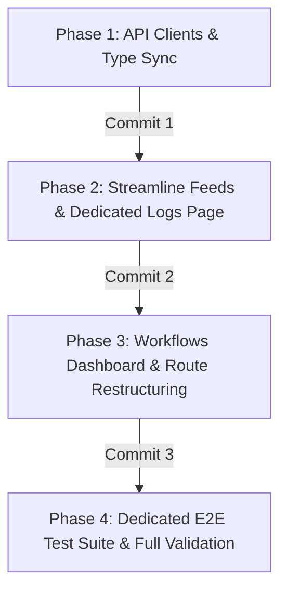

# Plan: Frontend Integration for Decoupled Automation Workflows

## Goal Description
Surface the newly implemented `AutomationWorkflow` backend functionality in the React frontend:
1. Make the **Workflows Dashboard** (`/`) the default application landing view.
2. Provide a persistent **Composer** (`/composer` / `/draft/:draftId`) for ad-hoc and review drafting.
3. Move the processing backlog and queue to a dedicated **Logs** page (`/logs`).
4. Streamline **Feeds** (`/feeds`) to focus purely on RSS/YouTube subscription management.
5. Create a dedicated **Playwright E2E Test Suite** (`e2e/tests/workflows.spec.ts`) covering full user journeys.

---

## Phased Implementation Roadmap & Commits



---

### Phase 1: API Clients & Contract Synchronization
**Commit**: `feat(web): add workflows api client and sync feed contracts`

#### Deliverables:
1. **[`web/src/api/workflows.ts`](file:///home/vhogemann/Projects/social-worker/web/src/api/workflows.ts)** [NEW]:
   - Complete TypeScript interfaces matching backend DTOs (`AutomationWorkflowDto`, `WorkflowSourceDto`, `WorkflowDestinationDto`, `CreateAutomationWorkflowRequest`).
   - API client functions: `fetchWorkflows()`, `createWorkflow()`, `updateWorkflow()`, `deleteWorkflow()`, `triggerWorkflow()`.
2. **[`web/src/api/feeds.ts`](file:///home/vhogemann/Projects/social-worker/web/src/api/feeds.ts)** [MODIFY]:
   - Remove `instructionPrompt` and `autoPublish` from `FeedSubscriptionDto`, `createFeed`, and `updateFeed`.
   - Update `FeedQueueItemDto` with `automationWorkflowId` and `automationWorkflowTitle`.
3. **[`web/src/api/workflows.test.ts`](file:///home/vhogemann/Projects/social-worker/web/src/api/workflows.test.ts)** [NEW]:
   - Vitest unit tests verifying client request serialization and error handling.

#### Verification:
```bash
docker compose --profile tooling run --rm web-test sh -c "npm run build && npm run typecheck"
```

---

### Phase 2: Streamline Feeds & Dedicated Logs Page
**Commit**: `feat(web): streamline feeds panel and create dedicated logs page`

#### Deliverables:
1. **[`web/src/components/FeedsPanel/FeedsPanel.tsx`](file:///home/vhogemann/Projects/social-worker/web/src/components/FeedsPanel/FeedsPanel.tsx)** [MODIFY]:
   - Clean, focused RSS/YouTube feed subscriptions CRUD without decoupled prompt/autoPublish fields.
2. **[`web/src/components/Logs/LogsPanel.tsx`](file:///home/vhogemann/Projects/social-worker/web/src/components/Logs/LogsPanel.tsx)** [NEW]:
   - Standalone processing backlog page displaying queue items with Status pills (`Pending`, `Processing`, `Succeeded`, `Failed`), attempt counts, last error, and timestamps.
   - Action buttons: "Retry Item", "Delete Item", "Refresh".
   - Status filters: `All`, `Waiting`, `Failed`, `Succeeded`.
3. **[`web/src/App.tsx`](file:///home/vhogemann/Projects/social-worker/web/src/App.tsx)** [MODIFY]:
   - Add `/logs` route and top navigation link.
4. **[`e2e/tests/feeds-logs.spec.ts`](file:///home/vhogemann/Projects/social-worker/e2e/tests/feeds-logs.spec.ts)** [NEW]:
   - E2E test verifying adding a feed subscription and viewing backlog queue items on `/logs`.

#### Verification:
```bash
docker compose --profile tooling run --rm web-test sh -c "npm run build && npm run typecheck"
./scripts/run-e2e.sh tests/feeds-logs.spec.ts
```

---

### Phase 3: Workflows Dashboard & Route Restructuring
**Commit**: `feat(web): implement workflows dashboard and route restructuring`

#### Deliverables:
1. **[`web/src/components/WorkflowsPanel/WorkflowsPanel.tsx`](file:///home/vhogemann/Projects/social-worker/web/src/components/WorkflowsPanel/WorkflowsPanel.tsx)** [NEW]:
   - Workflows grid displaying Title, Prompt summary, linked Feed source pills, Destination platform badges with Auto-Publish pills.
   - Action buttons: "Trigger Run", "Edit", "Delete".
   - **Create/Edit Workflow Modal**:
     - Title input & custom instruction prompt textarea.
     - **Feed Sources Checklist**: multi-select of active feeds from `fetchFeeds()`.
     - **Platform Destinations Selector**: dynamically filtered to authenticated accounts from `listAccounts()`, each with an "Auto-Publish when ready" toggle.
2. **[`web/src/components/EditorPanel/EditorPanel.tsx`](file:///home/vhogemann/Projects/social-worker/web/src/components/EditorPanel/EditorPanel.tsx)** [MODIFY]:
   - Header button: `← Workflows` (linking back to `/`).
3. **[`web/src/App.tsx`](file:///home/vhogemann/Projects/social-worker/web/src/App.tsx)** [MODIFY]:
   - Route `/` points to `WorkflowsPanel`.
   - Route `/composer` points to `ComposerView`.
   - Top navigation updated with `Workflows` as the primary home link.

#### Verification:
```bash
docker compose --profile tooling run --rm web-test sh -c "npm run build && npm run typecheck"
```

---

### Phase 4: Dedicated E2E Test Suite & Full Suite Validation
**Commit**: `test(e2e): add end-to-end test suite for automation workflows dashboard`

#### Deliverables:
1. **[`e2e/helpers/auth.ts`](file:///home/vhogemann/Projects/social-worker/e2e/helpers/auth.ts)** [MODIFY]:
   - Update `loginViaUi` helper to support landing on the dashboard.
2. **[`e2e/tests/workflows.spec.ts`](file:///home/vhogemann/Projects/social-worker/e2e/tests/workflows.spec.ts)** [NEW]:
   - Full user journey Playwright E2E tests:
     - Dashboard loads and displays existing workflows.
     - Creating a workflow with feed sources checklist and platform destination toggles.
     - Verifying workflow card appears on dashboard.
     - Editing a workflow.
     - Triggering a workflow run.
     - Navigating between Workflows Dashboard and Composer (`/composer`).
     - Deleting a workflow.
3. Full stack rebuild and E2E suite pass.

#### Verification:
```bash
./scripts/run-e2e.sh
```
