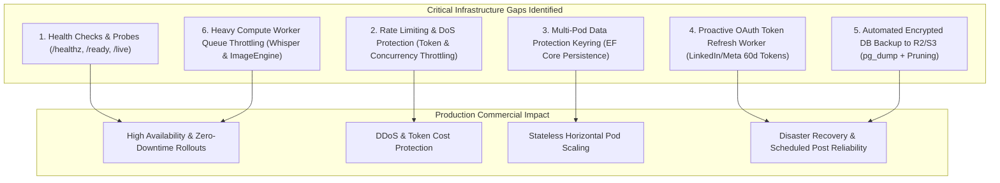

# Infrastructure Gaps & Production Hardening Master Plan

We conducted an architectural audit of SocialWorker across security, resilience, observability, state management, and compute scaling. This document details the **6 critical infrastructure gaps** identified and provides a concrete roadmap for hardening the platform for production.

---

## 1. Executive Summary of Infrastructure Gaps



---

## 2. Detailed Gap Analysis & Technical Solutions

---

### 🔴 Gap 1: Health Probes & Deep Dependency Readiness (`/healthz`, `/ready`, `/live`)
- **Current State**: No standard ASP.NET Core Health Checks mapped. Kubernetes and load balancers cannot probe container health or database connectivity.
- **Solution**: Register `Microsoft.AspNetCore.Diagnostics.HealthChecks` with checks for:
  1. **PostgreSQL Database** (Npgsql query ping).
  2. **Whisper Transcriber** (`http://transcriber:8000/health`).
  3. **Image Engine** (`http://image-engine:8000/health`).
  4. **SearXNG Search Engine** (`http://searxng:8080/`).
  5. **Blob Storage Gateway** (`IBlobStorageProvider`).
- **Endpoint Structure**:
  - `GET /healthz/live`: Lightweight process liveness probe.
  - `GET /healthz/ready`: Deep dependency readiness probe returning structured JSON.

#### Code Architecture:
```csharp
builder.Services.AddHealthChecks()
    .AddNpgSql(builder.Configuration.GetConnectionString("Default")!)
    .AddUrlGroup(new Uri("http://transcriber:8000/health"), "Transcriber")
    .AddUrlGroup(new Uri("http://image-engine:8000/health"), "ImageEngine")
    .AddUrlGroup(new Uri("http://searxng:8080/"), "SearXNG");

app.MapHealthChecks("/healthz/live", new HealthCheckOptions { Predicate = _ => false });
app.MapHealthChecks("/healthz/ready", new HealthCheckOptions
{
    ResponseWriter = UIResponseWriter.WriteHealthCheckUIResponse
});
```

---

### 🔴 Gap 2: Rate Limiting & Resource Protection
- **Current State**: Endpoints (including heavy AI chat SSE streams, web scraping, and Whisper transcription) have no rate limits. A runaway client or script can trigger excessive LLM token costs or CPU/GPU exhaustion.
- **Solution**: Implement ASP.NET Core .NET 10 `Microsoft.AspNetCore.RateLimiting` with partitioners:
  - **Chat & LLM Endpoints (`/api/chat`)**: Sliding window limit per User / IP (e.g. max 30 messages / min).
  - **Source Ingestion & Scraping (`/api/sources`)**: Concurrency limiter (e.g. max 5 concurrent scrapes).
  - **API Key / MCP Endpoints (`/api/mcp`)**: Token bucket limit per API Key (e.g. 120 requests / min).
  - **Auth Endpoints (`/api/auth/login`)**: Strict fixed window (e.g. 5 attempts / 5 mins) to prevent brute force.

---

### 🔴 Gap 3: Multi-Pod Data Protection Keyring Persistence
- **Current State**: Data Protection keys are stored in a local directory volume (`api-dataprotection-keys:/root/.aspnet/DataProtection-Keys`).
- **Problem**: When running multiple API pod replicas in Kubernetes or behind a load balancer, each pod has separate keys. This causes encrypted state mismatches, token signing errors, and session invalidation across pods.
- **Solution**: Persist Data Protection keys directly to PostgreSQL using `Microsoft.AspNetCore.DataProtection.EntityFrameworkCore`.
```csharp
builder.Services.AddDataProtection()
    .SetApplicationName("SocialWorker")
    .PersistKeysToDbContext<AppDbContext>();
```

---

### 🔴 Gap 4: Proactive OAuth Token Refresh Background Worker
- **Current State**: OAuth tokens (e.g. LinkedIn 60-day token, Meta 60-day token) are only refreshed during an active publishing attempt.
- **Problem**: Scheduled posts queued weeks in advance may fail at dispatch time if their OAuth access token has expired or if the refresh grant token expired.
- **Solution**: An `OAuthTokenRefreshHostedService` running daily that inspects `Accounts` where `TokenExpiresAt <= UtcNow + 3 days` and proactively calls the provider's token refresh endpoint.

---

### 🔴 Gap 5: Automated Database Backups & Offsite S3/R2 Snapshotter
- **Current State**: Database data relies solely on a local Docker volume (`pgdata`). No automated offsite backup exists.
- **Solution**: A lightweight backup service (`scripts/backup-db.sh` or a scheduled Kubernetes `CronJob`) that:
  1. Runs `pg_dump -Fc socialworker`.
  2. Encrypts the archive using AES-256 with the app's encryption key.
  3. Uploads the backup to Cloudflare R2 / S3 (`backups/db-YYYY-MM-DD-HHmm.sql.gz.enc`).
  4. Automatically prunes backups older than 30 days.

---

### 🔴 Gap 6: Heavy Compute Concurrency Throttling (Whisper & ImageEngine)
- **Current State**: Ingestion of YouTube feeds can enqueue multiple video transcriptions simultaneously.
- **Problem**: If 10 videos are processed at once, launching 10 concurrent Whisper instances will crash the container with an Out-of-Memory (OOM) error.
- **Solution**: Enforce a strict concurrency semaphore (e.g. `MaxConcurrentTranscriptions = 1` on CPU, `2` on GPU) inside `SourceTranscriptionTaskHandler`, leaving remaining tasks safely queued in the PostgreSQL `BackgroundTasks` table with `Pending` status.

---

## 3. Prioritized Implementation Roadmap

| Priority | Hardening Milestone | Components Changed | Effort |
| :--- | :--- | :--- | :--- |
| **P0** | **Health Probes & Liveness Endpoints** | `Program.cs`, `InfrastructureExtensions.cs`, `k8s/` | 1 day |
| **P0** | **Heavy Compute Concurrency Throttling** | `SourceTranscriptionTaskHandler.cs`, `BackgroundTaskHostedService.cs` | 1 day |
| **P1** | **Data Protection EF Core Persistence** | `AppDbContext.cs`, `0013_add_data_protection_keys.sql` | 1 day |
| **P1** | **ASP.NET Core Rate Limiting Policies** | `InfrastructureExtensions.cs`, `Program.cs` | 2 days |
| **P2** | **Proactive OAuth Token Refresh Worker** | `Features/Accounts/Services/OAuthTokenRefreshHostedService.cs` | 2 days |
| **P2** | **Automated Encrypted S3/R2 DB Backup Script** | `scripts/backup-db.sh`, `k8s/base/backup-cronjob.yaml` | 1 day |

---

## 4. Verification Plan

1. **Health Checks Verification**:
   - `curl http://localhost:8101/healthz/live` -> `200 OK`.
   - `curl http://localhost:8101/healthz/ready` -> `200 OK` with JSON breakdown of DB, Transcriber, ImageEngine, and SearXNG.
2. **Rate Limiting Verification**:
   - Dispatch 50 rapid requests to `/api/chat` and verify HTTP 429 Too Many Requests response with `Retry-After` header.
3. **Data Protection Multi-Pod Test**:
   - Launch 2 API instances sharing the same DB and verify encrypted tokens can be decrypted interchangeably.
