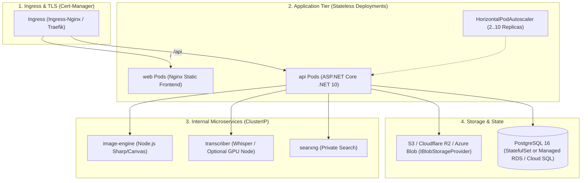

# Implementation Plan: Production Kubernetes (K8s) Deployment Architecture

We propose defining a standardized, production-ready **Kubernetes (K8s) deployment configuration** for SocialWorker. This provides enterprise customers and SaaS operators with a declarative, GitOps-ready deployment model using **Kustomize** and **Helm**, enabling zero-downtime rolling updates, automated pod autoscaling (HPA), ingress routing with automated TLS via cert-manager, and optional GPU node scheduling for Whisper transcription.

---

## 1. Kubernetes Cluster Architecture



---

## 2. Directory Layout & Packaging Structure

We will structure the deployment manifests under `k8s/` supporting both **Kustomize** (for GitOps tools like ArgoCD / Flux) and **Helm** (for 1-click package distribution):

```
k8s/
├── base/                              # Core declarative manifests
│   ├── kustomization.yaml
│   ├── namespace.yaml                 # social-worker namespace
│   ├── configmap.yaml                 # Common environment settings
│   ├── secrets.template.yaml          # Template for sensitive credentials
│   ├── api-deployment.yaml            # ASP.NET Core API with health probes
│   ├── api-service.yaml               # ClusterIP on port 8080
│   ├── api-hpa.yaml                   # HorizontalPodAutoscaler (CPU/Mem)
│   ├── web-deployment.yaml            # React Nginx frontend
│   ├── web-service.yaml               # ClusterIP on port 80
│   ├── image-engine-deployment.yaml   # Sharp template rendering engine
│   ├── image-engine-service.yaml      # ClusterIP on port 8000
│   ├── transcriber-deployment.yaml    # Whisper transcription service
│   ├── transcriber-service.yaml       # ClusterIP on port 8000
│   ├── searxng-deployment.yaml        # Private search instance
│   ├── searxng-service.yaml           # ClusterIP on port 8080
│   ├── db-statefulset.yaml            # Self-hosted Postgres 16 (optional)
│   ├── db-service.yaml                # ClusterIP on port 5432
│   ├── migration-job.yaml             # Pre-deployment migration job
│   └── ingress.yaml                   # Ingress rules with TLS
├── overlays/
│   ├── dev/                           # Local k3d/minikube/kind overlay
│   │   └── kustomization.yaml
│   ├── prod/                          # Production cloud overlay (EKS, GKE, AKS, Hetzner)
│   │   ├── kustomization.yaml
│   │   ├── ingress-patch.yaml         # Production domain & cert-manager issuer
│   │   └── gpu-transcriber-patch.yaml # NVIDIA GPU resource requests & nodeSelector
└── helm/                              # Helm 3 Chart
    ├── Chart.yaml
    ├── values.yaml                    # Default values (replicaCount, ingress, S3)
    └── templates/                     # Parameterized templates
```

---

## 3. Key Manifest Specifications

### A. API Deployment (`k8s/base/api-deployment.yaml`)
- **Zero-Downtime Rolling Update**: `maxSurge: 1, maxUnavailable: 0`.
- **Health Probes**:
  - `readinessProbe`: HTTP GET `/healthz` (delay 5s, period 10s).
  - `livenessProbe`: HTTP GET `/healthz` (delay 15s, period 20s).
- **Stateless Storage**: Wired to `IBlobStorageProvider` (Cloudflare R2 / AWS S3), eliminating shared PVC bottlenecks.
- **Resource Constraints**:
  - `requests: { cpu: 250m, memory: 512Mi }`
  - `limits: { cpu: 2000m, memory: 2Gi }`

### B. Transcriber Deployment (`k8s/base/transcriber-deployment.yaml`)
- Supports both **CPU-only** and **GPU-accelerated** nodes.
- **Production GPU Overlay (`k8s/overlays/prod/gpu-transcriber-patch.yaml`)**:
  ```yaml
  apiVersion: apps/v1
  kind: Deployment
  metadata:
    name: transcriber
  spec:
    template:
      spec:
        nodeSelector:
          accelerator: nvidia-gpu
        containers:
          - name: transcriber
            resources:
              limits:
                nvidia.com/gpu: 1
  ```
- **Whisper Model Cache**: Backed by a PersistentVolumeClaim (`whisper-cache-pvc`) so models are downloaded only once.

### C. Ingress with Automated TLS (`k8s/base/ingress.yaml`)
- Integrates with **Cert-Manager** (`cert-manager.io/cluster-issuer: letsencrypt-prod`).
- Routes `/api/` traffic to `api:8080` (with WebSocket & SSE streaming enabled for `/api/chat` and `/api/mcp/sse`).
- Routes all other traffic to `web:80`.

### D. Automated Migration Job (`k8s/base/migration-job.yaml`)
- Runs DbUp SQL migrations as a Kubernetes `Job` or Helm `pre-upgrade` hook before new API pods start accepting traffic, preventing database schema race conditions.

---

## 4. Production Configuration (`k8s/base/configmap.yaml` & `secrets.template.yaml`)

### ConfigMap Values:
```yaml
apiVersion: v1
kind: ConfigMap
metadata:
  name: socialworker-config
data:
  ASPNETCORE_ENVIRONMENT: "Production"
  LLM__Provider: "OpenRouter"
  LLM__BaseUrl: "https://openrouter.ai/api/v1"
  LLM__Model: "anthropic/claude-3.5-sonnet"
  Search__Provider: "SearXng"
  Search__SearXngBaseUrl: "http://searxng:8080"
  Transcriber__BaseUrl: "http://transcriber:8000"
  ImageEngine__BaseUrl: "http://image-engine:8000"
  Storage__Provider: "S3"
  Storage__S3__ServiceUrl: "https://<account_id>.r2.cloudflarestorage.com"
  Storage__S3__BucketName: "socialworker-media"
  Storage__S3__PublicBaseUrl: "https://media.mycompany.com"
```

### Secrets Template:
```yaml
apiVersion: v1
kind: Secret
metadata:
  name: socialworker-secrets
type: Opaque
stringData:
  ConnectionStrings__Default: "Host=db;Database=socialworker;Username=postgres;Password=..."
  Auth__JwtSecret: "..."
  Auth__DbEncryptionKey: "..."
  LLM__ApiKey: "..."
  Storage__S3__AccessKey: "..."
  Storage__S3__SecretKey: "..."
```

---

## 5. Verification & Testing Plan

1. **Local Kubernetes Validation (k3d / Minikube / Kind)**:
   - Run `kubectl kustomize k8s/overlays/dev` to validate manifest syntax and resource schema.
   - Deploy to a local cluster: `kubectl apply -k k8s/overlays/dev`.
   - Verify pod startup sequence: `migration-job` completes -> `db`, `image-engine`, `transcriber`, `searxng` start -> `api` and `web` become Ready.
2. **Horizontal Pod Autoscaling (HPA) Verification**:
   - Run a load test against `POST /api/mcp` and confirm `api` pods scale from 2 to 4+ replicas cleanly.
3. **Ingress & SSE Verification**:
   - Verify continuous SSE streaming through Ingress for `/api/chat` and `/api/mcp/sse`.
