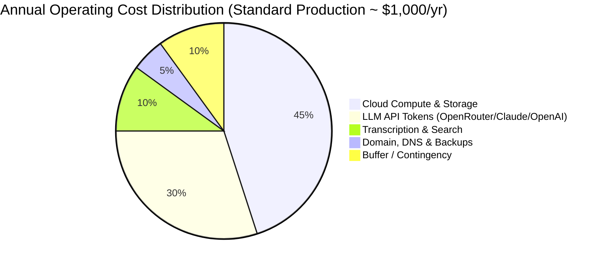

# 1-Year Operational Cost Estimate: Independent Launch (3–4 Clients)

## Executive Summary

Launching **social-worker** independently to serve **3 to 4 active clients** over a 12-month period is remarkably cost-effective due to its local-first, lightweight architecture (**ASP.NET Core .NET 10**, **PostgreSQL**, self-hosted **SearXNG**, and built-in **Whisper** container).

Depending on infrastructure choices (single shared server vs. isolated VPS per client) and whether Twitter/X paid API tiers are required:

| Operating Tier | Monthly Cost | Annual Cost (12 Months) | Expected Annual Revenue (3–4 Clients @ $200–$500/mo) | Estimated Net Margin |
| :--- | :--- | :--- | :--- | :--- |
| **Lean / Bootstrapped** | **$25 – $40 / mo** | **$300 – $480 / yr** | **$7,200 – $24,000 / yr** | **94% – 98%** |
| **Standard Production** | **$60 – $110 / mo** | **$720 – $1,320 / yr** | **$7,200 – $24,000 / yr** | **90% – 95%** |
| **Enterprise / Twitter Basic API** | **$160 – $220 / mo** | **$1,920 – $2,640 / yr** | **$12,000 – $36,000 / yr** | **80% – 90%** |

---

## 1. Workload & Usage Assumptions (3–4 Clients)

- **Clients**: 4 independent business / creator accounts.
- **Publishing Volume**: 4 threads per client per week $\approx$ **16 threads / month per client** $\rightarrow$ **64 threads / month total** (~768 threads / year).
- **Average Thread Size**: 4–7 segments per thread, multi-platform adapted (Bluesky, LinkedIn, Twitter/X).
- **AI Iteration turns**: ~10–15 assistant chat turns per thread (including research search, draft generation, tone refinement, and formatting).
- **Transcription**: ~5–10 YouTube videos or audio notes per client per month ($\approx$ 25–35 hours of audio per month total).
- **Web Search**: ~50–100 queries per client per month (~300 queries / month total).

---

## 2. Granular Cost Breakdown by Component

### 2.1 Cloud Hosting & Server Infrastructure

The baseline Docker Compose footprint:
- Postgres 16: ~150 MB RAM
- .NET 10 Minimal API: ~200 MB RAM
- Web (NGINX + React SPA): ~30 MB RAM
- SearXNG: ~150 MB RAM
- Whisper Transcriber: ~1.0 – 2.0 GB RAM (CPU mode, `base` or `small` model)
- **Total RAM required**: ~3.5 – 4.5 GB RAM.

#### Hosting Options:
1. **Single Dedicated Cloud VPS (Hetzner CPX31 - 4 vCPU, 8 GB RAM, 160 GB NVMe)**:
   - **€14.00 / month** ($\approx$ **$15.50 / month** $\rightarrow$ **$186 / year**).
2. **Isolated VPS per Client (4x Hetzner CX22 - 2 vCPU, 4 GB RAM)**:
   - **€18.00 / month** ($\approx$ **$20.00 / month** $\rightarrow$ **$240 / year**).
3. **US Cloud (DigitalOcean / Linode 8 GB)**:
   - **$48.00 / month** ($\rightarrow$ **$576 / year**).

---

### 2.2 LLM API Token Costs (OpenRouter / Anthropic / OpenAI)

- Total estimated tokens (64 threads/month $\times$ 55,000 tokens/thread): **~3.5 Million tokens/month**.

| Model Mix | Pricing (Input / Output per 1M) | Monthly Cost | Annual Cost |
| :--- | :--- | :--- | :--- |
| **Tier 1 (Flagship: Claude 3.5 Sonnet / GPT-4o)** | $3.00 / $15.00 | **$22.50 / mo** | **$270 / yr** |
| **Tier 2 (Hybrid: Claude 3.5 Haiku + Sonnet polish)** | $0.80 / $4.00 (avg) | **$6.00 / mo** | **$72 / yr** |
| **Tier 3 (Ultra-Low Cost: DeepSeek V3 / GPT-4o-mini)** | $0.15 / $0.60 | **$0.98 / mo** | **$12 / yr** |
| **Tier 4 (100% Self-Hosted: Ollama Llama 3.1 on local GPU)** | $0 API cost | **$0 / mo** | **$0 / yr** |

*Budgeting Recommendation*: Budget **$25 / month** ($300 / year).

---

### 2.3 Audio & Video Transcription (Whisper)

- **Self-Hosted Whisper Container**: **$0.00 / year** (runs on CPU inside server instance).
- **Groq Whisper Large v3 (Fast cloud fallback)**: $0.00067/min $\rightarrow$ **$1.20 / month** (**$14.40 / year**).
- **OpenAI Whisper API**: $0.006/min $\rightarrow$ **$10.80 / month** (**$130 / year**).

---

### 2.4 Private Web Search (SearXNG vs. Brave Search)

- **Self-Hosted SearXNG Container**: **$0.00 / year**.
- **Brave Search API Free Tier (2,000 queries/mo)**: **$0.00 / year**.

---

### 2.5 Social Network Developer API Fees

- **Bluesky**: **$0.00** (Open AT Protocol).
- **LinkedIn**: **$0.00** (Share on LinkedIn Developer API).
- **Facebook & Instagram**: **$0.00** (Meta Graph API).
- **Twitter / X**: **$0.00** (Free Tier: 1,500 tweet writes/month/app) or **$1,200 / year** ($100/mo Basic Tier if reading timelines is needed).

---

### 2.6 Domain, SSL, Backups & Monitoring

- **Domain Name**: ~$12 – $15 / year.
- **SSL / Reverse Proxy**: $0 (Let's Encrypt / Traefik).
- **Encrypted Backups (Cloudflare R2)**: $0 (10 GB free tier).
- **Monitoring (BetterStack / UptimeKuma)**: $0.
- **Transactional Emails (Resend free tier)**: $0.

---

## 3. Total Annual Cost Scenarios

| Item | Lean Bootstrap | Standard Pro (Recommended) | Enterprise + Twitter Paid |
| :--- | :--- | :--- | :--- |
| **Server Compute & RAM** | $186 / yr (Hetzner CPX31) | $240 / yr (Dedicated VPS) | $400 / yr (High-Availability Cloud) |
| **LLM Inference Tokens** | $100 / yr (Hybrid/Haiku) | $300 / yr (Claude 3.5 Sonnet) | $400 / yr (Unlimited Sonnet/GPT-4o) |
| **Audio Transcription** | $0 / yr (Local Whisper) | $25 / yr (Groq Whisper Fast) | $50 / yr (OpenAI Whisper) |
| **Web Search** | $0 / yr (SearXNG) | $0 / yr (SearXNG / Brave Free) | $0 / yr (Brave Free) |
| **Social APIs (BSKY, LI, FB, IG)**| $0 / yr | $0 / yr | $0 / yr |
| **Twitter / X API** | $0 / yr (Free Tier) | $0 / yr (Free Tier) | $1,200 / yr (Basic $100/mo Tier) |
| **Domain, DNS & Backups** | $15 / yr | $25 / yr | $50 / yr |
| **Contingency / Overage Buffer** | $30 / yr | $50 / yr | $100 / yr |
| **TOTAL 1-YEAR COST** | **$331 / year** | **$640 / year** | **$2,200 / year** |
| **MONTHLY EQUIVALENT** | **~$27.50 / month** | **~$53.30 / month** | **~$183.30 / month** |

---

## 4. Profitability & Margin Projections

| Pricing Strategy | Pricing per Client | Annual Gross Revenue (4 Clients) | Annual Operating Cost (Standard Pro) | Annual Net Profit | Profit Margin |
| :--- | :--- | :--- | :--- | :--- | :--- |
| **Low-Touch Self-Serve Tool** | $99 / mo | $4,752 / yr | $640 / yr | **$4,112 / yr** | **86.5%** |
| **Mid-Tier Agency / Pro Tool** | $250 / mo | $12,000 / yr | $640 / yr | **$11,360 / yr** | **94.7%** |
| **High-Touch Thought Leadership**| $500 / mo | $24,000 / yr | $640 / yr | **$23,360 / yr** | **97.3%** |
