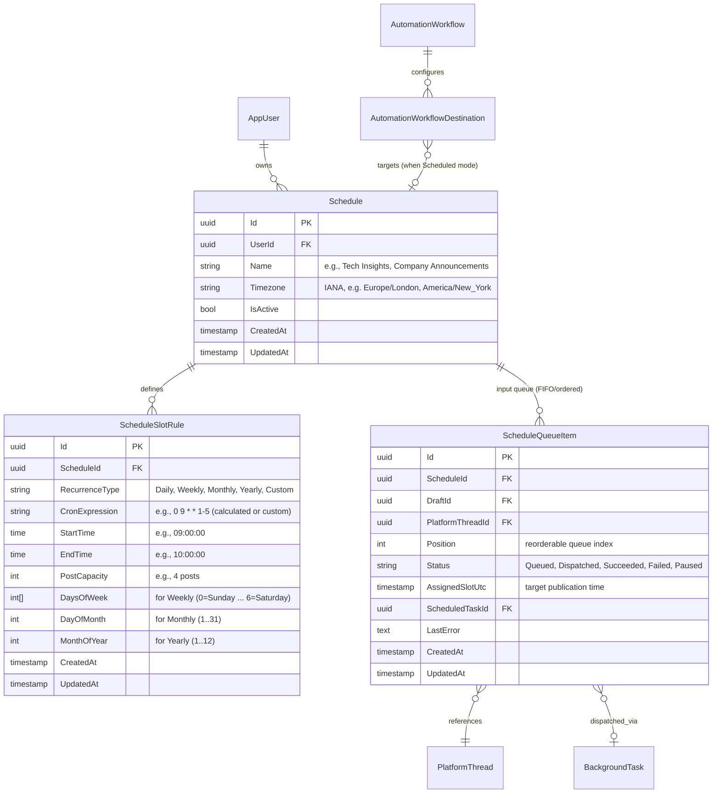
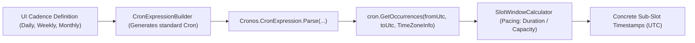
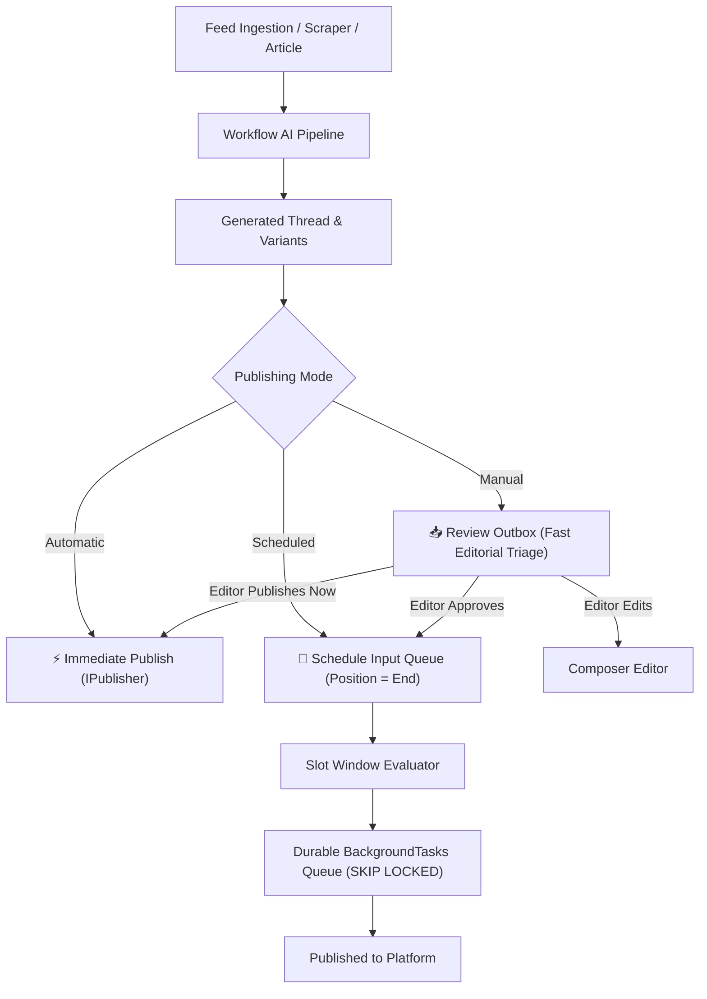
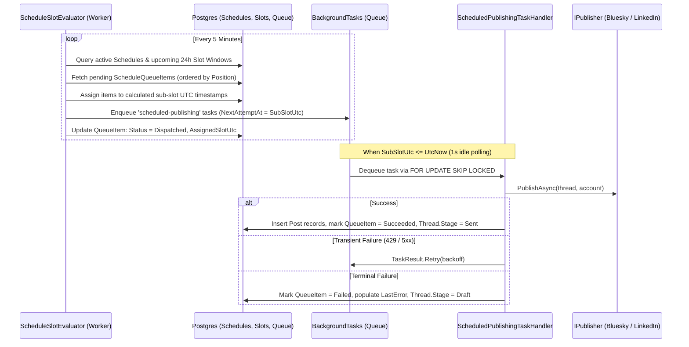

# Scheduled Publishing Engine Specification

## Overview

The **Scheduled Publishing Engine** provides a full-featured content calendar and paced scheduling system for social-worker. 

Instead of ad-hoc one-off date pickers, publication is organized around first-class **Schedules**, **Hierarchical Calendar Slot Windows** (Daily, Weekly, Monthly, Yearly), and an **Input Queue (Outbox)** per schedule. Multi-segment threads and single posts are paced evenly across designated time windows, preventing content dumping and automating delivery.

Automated workflows integrate directly via **3 Publishing Modes**:
1. **Manual Posting**: Directs generated drafts to a dedicated **Review Outbox** for fast editorial triage and approval.
2. **Automatic Posting**: Dispatches posts immediately upon generation and formatting.
3. **Scheduled Posting**: Routes posts directly into a chosen Schedule's Input Queue to fill upcoming calendar slots.

### Detailed Phase Plans:
* **Backend Implementation Plan (Milestones B1 – B4)**: [planning/scheduling/BACKEND_IMPLEMENTATION_PLAN.md](scheduling/BACKEND_IMPLEMENTATION_PLAN.md)
* **Frontend Implementation Plan (Milestones F1 – F5)**: [planning/scheduling/FRONTEND_IMPLEMENTATION_PLAN.md](scheduling/FRONTEND_IMPLEMENTATION_PLAN.md)

---

## 1. Domain & Data Architecture

### 1.1 Core Entities & Relationships



---

## 2. Slot Window Engine & Pacing Model

### 2.1 The Slot Window Concept

A slot is defined by a **Start Time**, an **End Time**, and a **Post Capacity** ($N$). Rather than blasting all posts at the start, posts are published at equal intervals across the window.

$$\text{Interval} = \frac{\text{EndTime} - \text{StartTime}}{\text{PostCapacity}}$$

#### Pacing Examples:
* **1-Hour Window with 4 Posts**:
  * Window: `09:00` to `10:00`, Capacity = 4.
  * Interval: $\frac{60\text{ min}}{4} = 15\text{ min}$.
  * Sub-slots:
    * Slot 1: `09:00`
    * Slot 2: `09:15`
    * Slot 3: `09:30`
    * Slot 4: `09:45`
* **3-Hour Afternoon Window with 6 Posts**:
  * Window: `14:00` to `17:00`, Capacity = 6.
  * Interval: $\frac{180\text{ min}}{6} = 30\text{ min}$ (posts at `14:00`, `14:30`, `15:00`, `15:30`, `16:00`, `16:45`).
* **Single Post Beat**:
  * Window: `08:30` to `08:30` (or Capacity = 1): exactly 1 post at `08:30`.

### 2.2 Under-Capacity & Empty Queue Behavior
* If the Input Queue contains fewer items than a window's capacity (e.g. 2 items for a 4-post window), the available items occupy the initial sub-slots (`09:00`, `09:15`). The remaining sub-slots simply pass unused without error.
* If the Input Queue is empty when a window opens, the window passes as an unused cycle.

### 2.3 Recurrence Calculation Engine: Cronos

To handle complex calendar recurrences, leap years, and Daylight Saving Time (DST) transitions safely, the engine onboards **`Cronos` (`0.13.0`)** as a zero-dependency calculation library.



#### How Cronos Powers the Pipeline:
1. **Cadence to Cron Translation**:
   - `Daily` at 09:00 → `0 9 * * *`
   - `Weekly` (Mon, Wed, Fri) at 10:00 → `0 10 * * 1,3,5`
   - `Monthly` (1st & 15th) at 14:00 → `0 14 1,15 * *`
   - `Monthly` (2nd Tuesday) at 11:00 → `0 11 * * 2#2`
   - `Monthly` (Last Friday) at 17:00 → `0 17 * * 5L`
   - `Custom`: Power users or automated workflows can supply standard 5-field cron.
2. **Timezone & DST Safety**:
   When evaluating a schedule, `Cronos` takes the schedule's `TimeZoneInfo` (e.g., `Europe/London`, `America/New_York`):
   ```csharp
   var timeZone = TimeZoneInfo.FindSystemTimeZoneById(schedule.Timezone);
   var windowStarts = cron.GetOccurrences(fromUtc, toUtc, timeZone, fromInclusive: true, toInclusive: false);
   ```
   DST shifts (spring forward / fall back) are resolved accurately by `Cronos` without custom timezone code.
3. **Decoupled Pacing Layer**:
   `Cronos` identifies the exact start of each window in UTC. The `SlotWindowCalculator` then slices that window into $N$ equal intervals:
   $$\text{SubSlotUtc}(k) = \text{WindowStartUtc} + k \times \frac{\text{Duration}}{\text{Capacity}}$$

---

## 3. Workflow Publishing Pipeline (3 Modes)

Each destination in an `AutomationWorkflow` specifies a `PublishingMode`:



1. **Mode 1: Manual Posting (Review Outbox)**:
   * Generated drafts do not clutter the primary drafts list.
   * They enter a dedicated **Review Outbox** triage dashboard.
   * Editors can inspect the thread, view source citations, make quick inline edits, and trigger:
     * `[Approve & Add to Schedule]`
     * `[Publish Now]`
     * `[Open in Composer]`
     * `[Reject / Delete]`
2. **Mode 2: Automatic Posting**:
   * Zero-touch: the moment generation passes validation, the thread is published to the target platform.
3. **Mode 3: Scheduled Posting**:
   * Autonomous pacing: the generated thread is pushed directly to the designated `Schedule`'s Input Queue.
   * It takes the next open calendar sub-slot according to that schedule's recurrence windows.

---

## 4. Execution Engine & Background Tasks Integration

The scheduling engine builds on top of the durable PostgreSQL 16 `FOR UPDATE SKIP LOCKED` task queue (`BackgroundTasks`):



---

## 5. API Surface

### 5.1 Schedules & Slots
* `GET /api/schedules`: List user's schedules with active slot summary and queue count.
* `POST /api/schedules`: Create schedule (`name`, `timezone`).
* `PUT /api/schedules/{id}`: Update schedule details.
* `DELETE /api/schedules/{id}`: Delete schedule and archive/unassign queue items.
* `GET /api/schedules/{id}/slots`: Get recurrence slot rules.
* `POST /api/schedules/{id}/slots`: Create slot rule (`recurrenceType`, `startTime`, `endTime`, `postCapacity`, `daysOfWeek`, etc.).
* `DELETE /api/schedules/{id}/slots/{slotId}`: Remove slot rule.

### 5.2 Schedule Queue (Outbox)
* `GET /api/schedules/{id}/queue`: Get ordered queue items with assigned upcoming slot times.
* `POST /api/schedules/{id}/queue`: Add platform thread to queue (`platformThreadId`, optional `position`).
* `PUT /api/schedules/{id}/queue/reorder`: Reorder queue positions (array of item IDs).
* `DELETE /api/schedules/{id}/queue/{itemId}`: Remove item from queue (reverts thread to Draft).
* `POST /api/schedules/{id}/queue/{itemId}/pause`: Pause or resume queue item.

### 5.3 Review Outbox (Workflow Triage)
* `GET /api/outbox`: List workflow-generated drafts waiting for manual review.
* `POST /api/outbox/{draftId}/approve`: Approve draft and route to a schedule or publish immediately (`{ "action": "queue", "scheduleId": "..." }` or `{ "action": "publish_now" }`).
* `DELETE /api/outbox/{draftId}`: Reject and delete or archive workflow draft.

### 5.4 Calendar Feed
* `GET /api/calendar`: Aggregated view of all scheduled slots and assigned posts across all user schedules for a specified date range (`start`, `end`).

---

## 6. Frontend Architecture & User Experience

### 6.1 Architectural Decision: Tailwind-Native CSS Grid Calendar

We evaluated third-party calendar libraries against social-worker's frontend stack (React 19, Tailwind CSS 3.4, dark developer palette):
* **`react-big-calendar`**: Disqualified due to open breaking issues and lack of stable support for React 19.
* **`FullCalendar` (`@fullcalendar/react`)**: Rejected due to heavyweight bundle size (~350KB), complex legacy table DOM, and massive CSS specificity friction when overriding styles to match our dark `#0f1115` / `#161922` theme.
* **`Schedule-X` (`@schedule-x/react`)**: Modern, but relies on its own Material Design SCSS theme and lacks native concepts for slot window containers with capacity pacing.
* **Decision**: Implement a **Tailwind-Native CSS Grid Calendar** (`CalendarPage.tsx` and subcomponents).

#### Key Advantages of the Tailwind-Native Approach:
1. **100% Theme Coherence**: Inherits the exact app tokens (`bg: #0f1115`, `panel: #161922`, `border: #262a36`, `accent: #7c8cff`, FontAwesome icons) with zero CSS conflicts or `!important` hacks.
2. **Native "Slot Window" Domain Representation**: Directly renders container blocks (`09:00 - 10:00 [Capacity: 4 | 3 filled]`) with discrete sub-slot cards (`09:00`, `09:15`, `09:30`, `09:45`).
3. **React 19 Native Drag-and-Drop**: Clean drag-and-drop reordering between the queue sidebar and calendar slots using standard HTML5 drag-and-drop or `@dnd-kit/core`.
4. **Lightweight Footprint**: Zero external runtime overhead (<12 KB component code).

---

### 6.2 Calendar Layout & Wireframe

```
+---------------------------------------------------------------------------------------------------+
| AppHeader:  Drafts  |  Templates  |  Feeds  |  Workflows  |  Outbox (3)  |  [Calendar]            |
+---------------------------------------------------------------------------------------------------+
| Active Schedule: [ Daily Tech Beat (UTC+1) v ]  [+ New Schedule]   Views: [ Day | Week | Month ]  |
+-----------------------------------------------------------------------------------+---------------+
| CALENDAR TIMELINE VIEW                                                            | INPUT QUEUE   |
|                                                                                   | (Reorderable) |
| 09:00 - 10:00 Window  [Capacity: 4 posts | 3 filled]                             |               |
| +-------------------------------------------------------------------------------+ | 1. 🦋 AI News |
| | [09:00] 🦋 @tech.bsky: "Vector search in .NET 10"               [Sent]       | | 2. 💼 Hiring  |
| | [09:15] 🦋 @tech.bsky: "LLM Orchestration update"               [Queued]     | | 3. 🦋 Bench-  |
| | [09:30] 💼 LinkedIn: "Why Postgres SKIP LOCKED scales"          [Queued]     | |    marks      |
| | [09:45] [ + Queue Next Draft from Outbox/Library ]                           | |               |
| +-------------------------------------------------------------------------------+ | [+ Add Draft] |
|                                                                                   |               |
| 14:00 - 15:00 Window  [Capacity: 2 posts | 0 filled]                             |               |
| +-------------------------------------------------------------------------------+ |               |
| | [14:00] [ + Empty Slot ]                                                      | |               |
| | [14:30] [ + Empty Slot ]                                                      | |               |
| +-------------------------------------------------------------------------------+ |               |
+-----------------------------------------------------------------------------------+---------------+
```

---

### 6.3 Component Breakdown

1. **`CalendarPage.tsx` (`/calendar`)**:
   - Schedule Selector Header: active schedule dropdown, timezone badge, "+ New Schedule" trigger.
   - View Mode Switcher: Day, Week, Month.
   - Main Grid:
     - **Month View**: 7-column CSS grid (`grid-cols-7`) showing day cells with slot window indicator pills and post count dots.
     - **Week View**: 7-column time-grid with hourly rows, rendering slot window blocks spanning from `StartTime` to `EndTime`, displaying sub-slot post cards inside.
     - **Day View**: Detailed single-day timeline showing slot windows, sub-slots, post previews, character counts, and publishing status.
   - Empty Sub-Slot Drop Target: Click or drop to assign an unassigned draft into that exact slot.

2. **`QueueSidebar.tsx`**:
   - Reorderable list of pending queue items for the active schedule.
   - Drag handles for quick FIFO priority reordering (reorders `Position`).
   - Pause/Resume and Remove actions per item.
   - "+ Add Draft" button opening a quick-picker modal of ready drafts.

3. **`ScheduleManagerModal.tsx`**:
   - Create/edit schedules (Name, IANA Timezone search picker).
   - Slot Rule Editor:
     - Time range inputs (`Start: 09:00`, `End: 10:00`).
     - Post capacity input (e.g. `4 posts`).
     - Recurrence selector: `Daily`, `Weekly` (weekday toggles Mon-Sun), `Monthly`, `Yearly`.
     - Live interval preview: *"Publishes 1 post every 15 minutes"*.

4. **`ReviewOutboxPage.tsx` (`/outbox`)**:
   - Dedicated navigation item with badge count (`📥 Outbox (3)`).
   - Card feed for workflow-generated drafts in `Manual` mode.
   - Quick action bar:
     - `[Approve & Add to Schedule ▾]` (routes to default or selected schedule).
     - `[Publish Now]`.
     - `[Edit in Composer]`.
     - `[Dismiss / Reject]`.

5. **`EditorPanelHeader.tsx` (Composer Integration)**:
   - Split publishing button:
     - Primary: `Publish Now`.
     - Dropdown options:
       - `Add to "Daily Tech Beat" (Next slot: Today 09:15)`.
       - `Add to "Company LinkedIn"`.
       - `Manage Schedules...` (navigates to `/calendar`).


