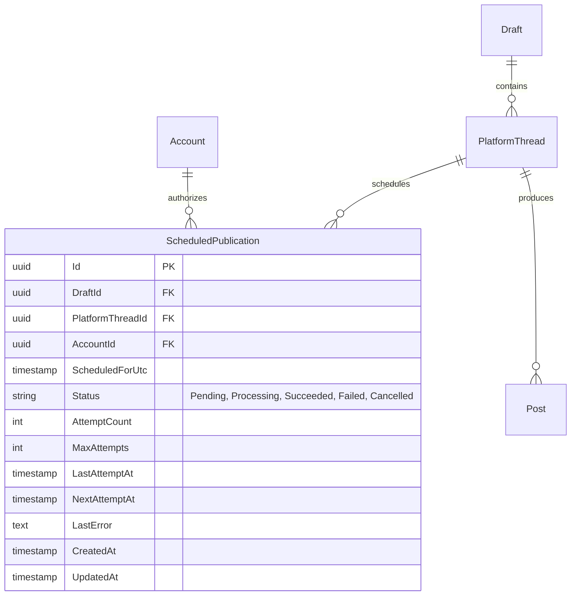
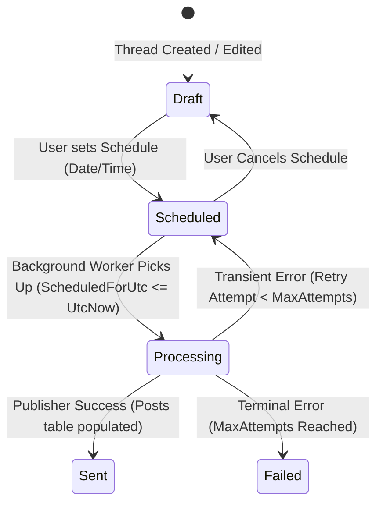

# Scheduled Publishing Engine Specification

## Overview

The **Scheduled Publishing Engine** allows users to schedule multi-segment threads and single posts for automated publication at a designated future time across all supported platforms (Bluesky, LinkedIn, Twitter/X, etc.).

## 1. Domain & Data Architecture

### 1.1 Database Entities



### 1.2 State Lifecycle



## 2. Backend Engine Implementation

### 2.1 Hosted Service (`ScheduledPublishingHostedService`)
- Background polling service executing every 30 seconds.
- Queries pending publications:
  ```csharp
  var dueItems = await db.ScheduledPublications
      .Include(s => s.PlatformThread)
      .Include(s => s.Draft)
      .Include(s => s.Account)
      .Where(s => s.Status == ScheduleStatus.Pending 
               && s.ScheduledForUtc <= DateTime.UtcNow 
               && (s.NextAttemptAt == null || s.NextAttemptAt <= DateTime.UtcNow))
      .OrderBy(s => s.ScheduledForUtc)
      .Take(20)
      .ToListAsync(ct);
  ```
- Uses transactional leasing to mark items as `Processing`.
- Invokes resolved `IPublisher.PublishAsync(...)`.
- On success: updates `PlatformThread.Stage = PlatformThreadStage.Sent`, adds `Post` entities, marks publication `Succeeded`.
- On failure: applies exponential backoff (e.g. 1m, 5m, 15m) or marks `Failed`.

### 2.2 Endpoints (`PublishingEndpoint.cs`)

- `POST /api/drafts/{draftId}/threads/{threadId}/schedule`
  - Body: `{ "scheduledAt": "2026-08-25T14:00:00Z" }`
  - Validates content readiness, checks target account, creates `ScheduledPublication`, sets `PlatformThread.Stage = PlatformThreadStage.Scheduled`.
- `DELETE /api/drafts/{draftId}/threads/{threadId}/schedule`
  - Cancels pending schedule, reverts thread stage to `Draft`.
- `GET /api/publishing/scheduled`
  - Lists user's pending scheduled publications with metadata.

## 3. Frontend Integration

1. **Schedule Modal (`ScheduleModal.tsx`)**:
   - Date-time picker restricting selection to future timestamps.
   - Live timezone preview (local browser time + UTC).
2. **Composer Publishing Bar**:
   - Replaces "Publish" with dropdown/split button: "Publish Now" or "Schedule...".
   - Shows "Scheduled for [Date/Time]" badge when stage is `Scheduled`.
3. **Queue Overview (`ScheduledQueuePanel.tsx`)**:
   - Central view of all scheduled upcoming content with edit, reschedule, and cancel actions.
