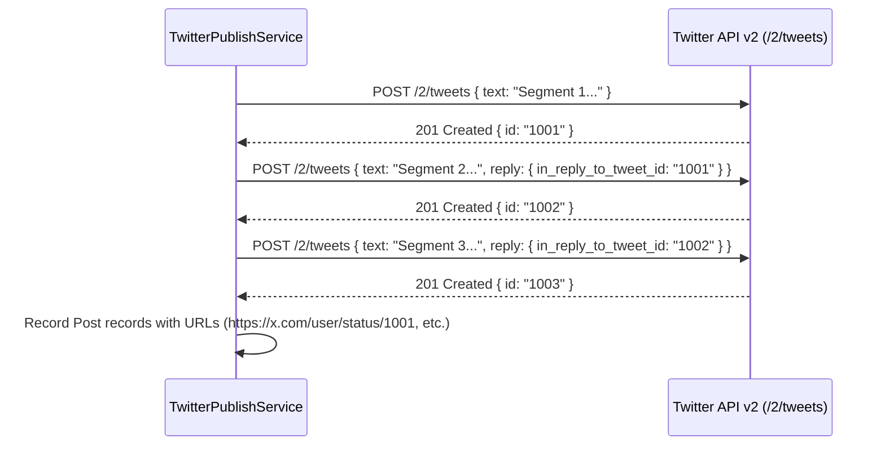

# Twitter / X Publisher Specification

## Overview

Replaces the placeholder `StubPublishers.TwitterPublisher` with a production **OAuth 2.0 PKCE** connector and **Twitter API v2** thread publisher.

## 1. Authentication (OAuth 2.0 PKCE)

### 1.1 Scopes & Flow
- Required Scopes: `tweet.read`, `tweet.write`, `users.read`, `offline.access`.
- Flow:
  1. Frontend / API generates PKCE code verifier & code challenge (`S256`).
  2. Redirects to Twitter authorization URL: `https://twitter.com/i/oauth2/authorize`.
  3. Callback receives authorization `code` and exchanges it for `access_token` and `refresh_token` (`POST https://api.twitter.com/2/oauth2/token`).
  4. Queries `https://api.twitter.com/2/users/me` for user ID and `@handle`.
  5. Stores encrypted credentials in `Accounts` table.

## 2. Publishing Pipeline (Twitter API v2)

### 2.1 Thread Chaining Architecture

### 2.2 Formatting & Validation (`TwitterContentValidator`)
- Maximum 280 weighted characters per segment.
- URLs automatically budgeted as 23 characters (`t.co` shortening).
- Emoji & Unicode multi-byte length weighting according to Twitter text specification.

## 3. Frontend Integration

1. **Preview (`TwitterThreadPreview.tsx`)**:
   - Renders Twitter/X styling with vertical connecting thread lines.
   - Character count indicator (e.g. `245/280`).
2. **Account Management**:
   - Connect Twitter button in Settings triggering OAuth 2.0 PKCE.
