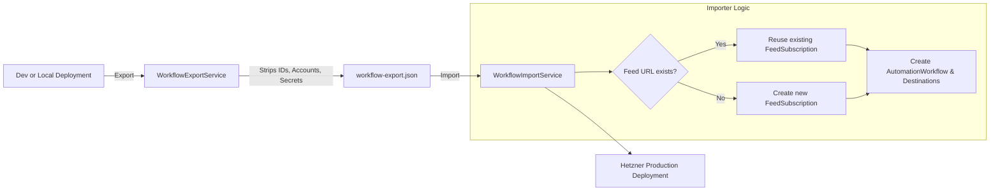

# Implementation Plan: Workflow & Source Export/Import Subsystem (Credential-Free Migration)

## 1. Problem & Goal

When spinning up a new deployment (such as migrating from local development to a Hetzner Cloud VPS), moving workflows and their associated feed source definitions currently requires either manual recreation or a raw PostgreSQL database dump and restore. 

Dumping the entire database has major drawbacks:
1. **Security & Credential Leakage**: Database dumps include encrypted OAuth refresh tokens, platform access tokens, user passwords, and JWT encryption keys.
2. **Environment Contamination**: Primary keys (`Guid`), development test posts, and temporary artifacts are ported over.

### Objective
Provide a clean, declarative **Export/Import Subsystem** for **Workflows and Source Definitions**:
- **Portable & Declarative**: Exported as versioned JSON.
- **Zero-Credential Guarantee**: Strips all user credentials, OAuth tokens, account secrets, and machine-specific database IDs.
- **Smart Source Resolution & Deduplication**: When importing, existing feed subscriptions matching `FeedUrl` are automatically reused rather than duplicated.
- **Omni-Channel Access**: Accessible via REST API, Web UI (file download/upload), and MCP tools (`export_workflow`, `import_workflow`).

---

## 2. Schema Specification: `WorkflowExportPackage`

```json
{
  "version": 1,
  "exportedAt": "2026-10-19T11:55:00Z",
  "workflows": [
    {
      "title": "AI & Tech Digest",
      "instructionPrompt": "Summarize this article as a thread.",
      "minRelevanceScore": 7,
      "sources": [
        {
          "kind": "Feed",
          "feed": {
            "title": "OpenAI News",
            "feedUrl": "https://openai.com/news/rss.xml",
            "websiteUrl": "https://openai.com/news",
            "includeFilters": "GPT,API",
            "excludeFilters": "Hiring"
          },
          "configurationJson": null
        }
      ],
      "destinations": [
        {
          "platform": "Bluesky",
          "publishingMode": "Manual",
          "autoPublish": false
        },
        {
          "platform": "Twitter",
          "publishingMode": "Automatic",
          "autoPublish": true
        }
      ]
    }
  ]
}
```

---

## 3. Architecture & Components



### Backend (ASP.NET Core .NET 10)
1. **Models** (`Features/Workflows/Models/WorkflowExportModels.cs`):
   - `WorkflowExportPackage`
   - `ExportedWorkflowDto`
   - `ExportedWorkflowSourceDto`
   - `ExportedFeedDefinitionDto`
   - `ExportedWorkflowDestinationDto`
   - `WorkflowImportResult`
2. **Service** (`Features/Workflows/Services/WorkflowPortabilityService.cs`):
   - `ExportAsync(Guid userId, Guid? workflowId = null, CancellationToken ct = default)`
   - `ImportAsync(Guid userId, WorkflowExportPackage package, CancellationToken ct = default)`
3. **Endpoints** (`Features/Workflows/WorkflowsEndpoint.cs`):
   - `GET /api/workflows/export`: Exports all workflows for the authenticated user.
   - `GET /api/workflows/{id:guid}/export`: Exports a single workflow.
   - `POST /api/workflows/import`: Imports workflows from JSON payload.
4. **MCP Tools** (`Features/Mcp/Services/McpToolRegistry.cs`):
   - `export_workflow`: Exports one or all workflows as JSON.
   - `import_workflow`: Imports workflows from a JSON string or payload.

### Frontend (React 19, TypeScript, Tailwind)
1. **API Client** (`web/src/api/workflows.ts`):
   - `exportWorkflowsApi(workflowId?: string)`
   - `importWorkflowsApi(package: WorkflowExportPackage)`
2. **UI Controls**:
   - Workflows Header: "Import" button opening an import modal (file upload or paste JSON).
   - "Export All" button in the workflows header menu.
   - "Export" option in individual `WorkflowCard` menu and `WorkflowDetailHeader`.

---

## 4. Test-Driven Verification

1. Unit tests in `SocialWorker.Api.Tests/Features/Workflows/WorkflowPortabilityTests.cs`:
   - `Export_StripsSensitiveData_PreservesFeedDefinitions`: Asserts no tokens, account IDs, or secrets are present in export.
   - `Import_CreatesNewWorkflowsAndFeeds`: Asserts valid import of brand-new workflows and feeds.
   - `Import_DeduplicatesExistingFeeds`: Asserts feeds matching existing `FeedUrl` are reused without duplicate DB rows.
   - `ExportImport_Roundtrip_PreservesConfiguration`: Full export $\rightarrow$ import roundtrip verification.
2. Web tests in `web/src/components/WorkflowsPanel/WorkflowImportModal.test.tsx`.
