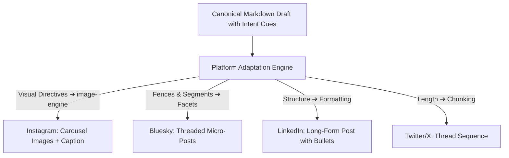
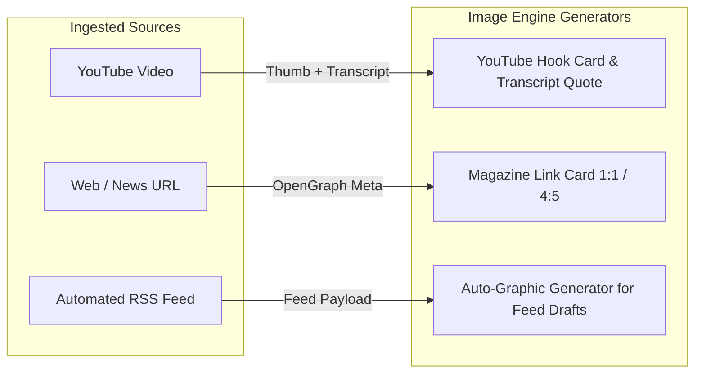
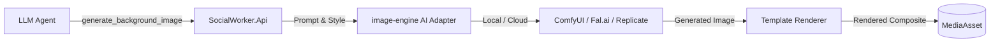

# Image Engine Extensions: Semantic Markdown Dialect & Horizon Capabilities

## Context & Purpose

This document serves as the sidecar reference for future enhancements to the `image-engine` microservice and the `social-worker` authoring pipeline. It covers:
1. **Enhanced Markdown Dialect with Cross-Platform Intent Cues**: Giving authors and the LLM agent semantic intent markers that translate cleanly across Instagram, Bluesky, LinkedIn, Twitter/X, and Facebook.
2. **Source Ingestion Synergies**: Automated generation of visual social assets from YouTube transcripts, web articles, and RSS feeds.
3. **Horizon Image Engine Capabilities**: URL link cards, multi-slide carousel decks, metric/infographic cards, smart focal-point cropping, and batch brand watermarking.

---

## 1. Cross-Platform Intent & Semantic Markdown Dialect

### The Platform Dilemma

| Platform | Text Model | Link Model | Visual Model |
| :--- | :--- | :--- | :--- |
| **Instagram** | Single caption (2,200 chars) | **Non-clickable plain text** | **Mandatory visual** (1 image or 2–10 carousel slides) |
| **Bluesky** | Thread of short posts (300 chars) | Clickable facets / link cards | 1–4 inline images per post |
| **LinkedIn** | Single long-form post (3,000 chars) | Clickable inline URLs | 1 image or multi-page PDF/carousel |
| **Twitter/X** | Thread of posts (280 chars) | Clickable cards / inline URLs | 1–4 inline images per post |

To author once and publish everywhere, the Markdown dialect supports non-invasive semantic intent cues.



---

### Syntax & Intent Specifications

#### A. Visual Card Directives (`:::card[...]`)

Block directives that compile into high-quality rendered images on visual-first platforms (Instagram) while gracefully degrading to formatted text on text-first platforms (Bluesky, LinkedIn, Twitter).

##### 1. Quote Card Directive
```markdown
:::card[quote]
quote: "Simplicity is prerequisite for reliability."
author: "Edsger W. Dijkstra"
bg: media://123e4567-e89b-12d3-a456-426614174000
:::
```
- **Instagram**: Renders a 1:1 or 4:5 Quote Card PNG via `image-engine` and attaches it to the post container.
- **Bluesky / Twitter**: Compiles to `> "Simplicity is prerequisite for reliability." — Edsger W. Dijkstra`.
- **LinkedIn**: Compiles to a formatted blockquote.

##### 2. Metric / Stat Highlight Directive
```markdown
:::card[metric]
value: "98.4%"
label: "System Uptime Across 12 Regions"
trend: "+4.2% YoY"
:::
```
- **Instagram**: Renders a high-contrast metric badge card with glowing typography.
- **Bluesky / LinkedIn**: Compiles to `📊 98.4% — System Uptime Across 12 Regions (+4.2% YoY)`.

##### 3. Link & Open Graph Card Directive
```markdown
:::card[link]
url: https://www.bbc.com/news/technology-12345
cta: "Link in bio"
:::
```
- **Instagram**: Renders a magazine-style Open Graph preview image (hero image, domain pill `bbc.co.uk`, favicon, headline, and "Link in bio" bar).
- **Bluesky / LinkedIn**: Compiles to a standard clickable link: `[Article Title](https://...)`.

---

#### B. Segment Roles (`<!-- role: slide -->` vs `<!-- role: caption-only -->`)

When composing a multi-segment draft separated by `---`:

```markdown
# 5 Architecture Rules Every Senior Dev Follows
Here are the core principles that save teams months of refactoring.

---
<!-- role: slide -->
## 1. Make Invalid States Unrepresentable
Encapsulate validation in domain entity factories. Don't let bad state enter the system.

---
<!-- role: slide -->
## 2. Stateless Core, Stateful Shell
Keep computation pure and push I/O and persistence to the boundaries.

---
<!-- role: caption-only -->
What's your #1 architecture rule? Drop it in the comments below! 👇

#SoftwareArchitecture #CleanCode #DevCommunity
```

- **Cross-Platform Compilation**:
  - **Instagram**: Segments with `<!-- role: slide -->` are batch-rendered into sequential carousel slide images (1..N). Segments with `<!-- role: caption-only -->` are merged into the post caption.
  - **Bluesky / Twitter**: All segments remain ordered thread posts.
  - **LinkedIn**: Merged into a unified long-form article format with section headers.

---

#### C. Smart Link Intent Modifiers

Because Instagram captions do not support clickable links:
- Input: `[Read the full breakdown](https://example.com/deep-dive)`
- **Instagram Compiler**: Automatically replaces caption link with `"🔗 Link in bio"` (or `"Read the full breakdown (Link in bio)"`).
- **Bluesky / LinkedIn Compiler**: Preserves native clickable markdown links.

---

#### D. Platform-Scoped Escape Hatches (`:::only[...]`)

```markdown
:::only[instagram]
Swipe left for all 5 rules ⬅️ Save this post for your next system design review!
:::

:::only[bluesky,twitter]
Repost if this helped you! 🔁
:::
```

Content inside `:::only[...]` is included solely when compiling the target platform's variant.

---

## 2. Source Ingestion Synergies



### 1. YouTube Source Tri-Pack Assets
When a YouTube video is ingested as a source, `social-worker` extracts metadata and transcripts (via `transcriber`). The Image Engine can generate 3 companion assets:
1. **Video Hook Card**: Video thumbnail + play icon overlay + channel avatar + duration badge (`14:22`) + title.
2. **Key Takeaway Slide**: Darkened video frame + 3 concise summary bullet points from the transcript.
3. **Timestamped Pull-Quote**: A key quote from the transcript with video timestamp indicator (`"At 04:15"`).

### 2. Open Graph Article Previews
Generates magazine-style 1:1 or 4:5 social cards from arbitrary URLs (BBC, CNN, Substack, TechCrunch, GitHub):
- Hero image in upper 60%.
- Brand domain pill (e.g. `bbc.co.uk`) with favicon.
- Headline and sub-headline with typographic scale.
- Bottom CTA bar ("Link in bio" / "Swipe up").

### 3. Automated RSS Feed Graphics
When the background feed ingestion queue discovers a new RSS item, it can call `image-engine` with a predefined brand template to automatically produce a branded graphic, ensuring auto-generated drafts are instantly publication-ready with visual media.

---

## 3. Horizon Image Engine Endpoints

| Endpoint | Method | Input Payload | Output | Description |
| :--- | :--- | :--- | :--- | :--- |
| `/render/link-card` | `POST` | JSON `{ title, domain, faviconUrl?, heroImageUrl?, ctaText?, theme? }` | PNG Image | Renders an Open Graph magazine link card for Instagram. |
| `/render/youtube-card` | `POST` | JSON `{ title, channel, duration, thumbnailUrl, quote?, timestamp? }` | PNG Image | Renders YouTube hook or quote card with video play chrome. |
| `/render/carousel` | `POST` | JSON `{ slides: [{ title, body, role? }], brandHandle?, theme? }` | ZIP / Array of PNGs | Batch renders ordered 1:1 or 4:5 carousel slide images with pagination indicators (`1 / 5`, `Swipe ➔`). |
| `/render/metric-card` | `POST` | JSON `{ value, label, trend?, theme? }` | PNG Image | Renders a KPI / metric highlight badge card. |
| `/transform/smart-crop` | `POST` | Multipart: image + `target_ratio` (`"1:1"`, `"4:5"`, `"9:16"`) | Binary Image | Uses `sharp.strategy.attention` to crop landscape images to portrait while preserving faces/focal points. |
| `/transform/watermark` | `POST` | Multipart: image + watermark logo + `{ position, opacity, scale }` | Binary Image | Applies brand logo and social handle watermark across images. |

---

## 4. Smart Processing & Quality Guardrails

### 1. Smart Focal-Point Cropping (Attention / Entropy Strategy)
Offloads focal-point detection to Sharp's native C++ engine without custom bounding-box algorithms:
```typescript
await sharp(inputBuffer)
  .resize(1080, 1350, {
    fit: 'cover',
    position: sharp.strategy.attention // Preserves faces, subjects, high-contrast focal points
  })
  .toBuffer();
```

### 2. WCAG Contrast & Legibility Scrims
When overlaying text on dynamic background images:
- Calculate relative luminance of the underlying image region.
- If contrast ratio < 4.5:1 (WCAG AA), automatically apply a subtle gradient scrim or semi-transparent pill backdrop behind the text.

### 3. Batch Brand Kit Watermarking
- Apply brand watermarks (logo + social handle `@brand`) to all media attached to a draft in one atomic action prior to publishing.

---

## 5. Pluggable AI Background Generator Adapter

An extensible adapter interface in `image-engine` allowing the LLM agent to generate AI images (via local ComfyUI or cloud APIs like Fal.ai, Replicate, or OpenAI) and pipe the generated asset directly into the template engine as the `background_image` slot.


