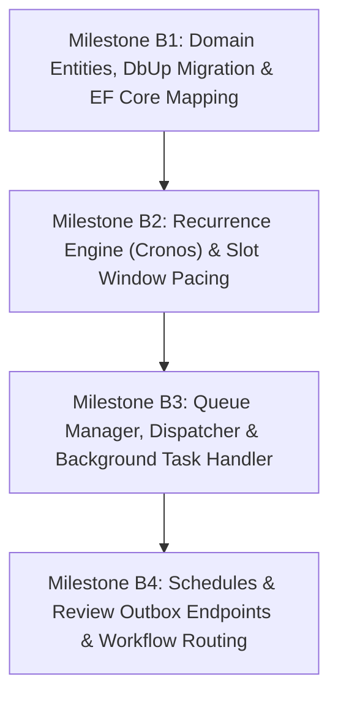

# Backend Implementation Plan: Scheduled Publishing & Content Calendar Engine

## Overview
This document specifies the phased backend implementation of social-worker's Content Calendar & Scheduled Publishing Engine. It details domain models, migration scripts, recurrence math using `Cronos`, task queue execution using PostgreSQL 16 `SKIP LOCKED` (`BackgroundTasks`), and API endpoints.

---

## Milestone Summary & Dependencies



---

## Milestone B1: Domain Entities, DbUp Migration & EF Core Mapping

### Goal
Establish the database schema, entity models, enums, and foreign-key mappings for `Schedule`, `ScheduleSlotRule`, and `ScheduleQueueItem`, while migrating existing `AutomationWorkflowDestination` records to support `PublishingMode`.

### Deliverables
1. **NuGet Dependency**:
   - Add `Cronos` (`0.13.0`) to `SocialWorker.Api.csproj`.
2. **Domain Enums** (`SocialWorker.Api/Data/Enums.cs`):
   - `WorkflowPublishingMode { Manual, Automatic, Scheduled }`
   - `SlotRecurrenceType { Daily, Weekly, Monthly, Yearly, Custom }`
   - `ScheduleQueueItemStatus { Queued, Dispatched, Succeeded, Failed, Paused }`
   - Add `PlatformThreadStage.Scheduled`.
3. **Entities** (`SocialWorker.Api/Data/Entities/`):
   - `Schedule.cs`: Id, UserId, Name, Timezone, IsActive, SlotRules, QueueItems, CreatedAt, UpdatedAt.
   - `ScheduleSlotRule.cs`: Id, ScheduleId, RecurrenceType, CronExpression, StartTime, EndTime, PostCapacity, DaysOfWeek, DayOfMonth, MonthOfYear.
   - `ScheduleQueueItem.cs`: Id, ScheduleId, DraftId, PlatformThreadId, Position, Status, AssignedSlotUtc, ScheduledTaskId, LastError.
   - Update `AutomationWorkflowDestination.cs`: add `PublishingMode` (default `Manual`) and `ScheduleId` (nullable FK).
4. **DbUp SQL Migration** (`SocialWorker.Api/Data/Migrations/0012_add_schedules_and_calendar.sql`):
   - Create tables `"Schedules"`, `"ScheduleSlotRules"`, `"ScheduleQueueItems"`.
   - Add `"PublishingMode"` (int) and `"ScheduleId"` (uuid FK nullable) to `"AutomationWorkflowDestinations"`.
   - Data migration: set `PublishingMode = 1` (Automatic) where `AutoPublish = true`, else `0` (Manual).
   - Create index `"IX_ScheduleQueueItems_ScheduleId_Position"` on `("ScheduleId", "Position")`.
   - Create index `"IX_ScheduleQueueItems_Status_AssignedSlotUtc"` on `("Status", "AssignedSlotUtc")`.
5. **EF Core Mapping** (`SocialWorker.Api/Data/AppDbContext.cs`):
   - Register `DbSet<Schedule>`, `DbSet<ScheduleSlotRule>`, `DbSet<ScheduleQueueItem>`.
   - Configure cascade delete from `Schedule` to `SlotRules` and `QueueItems`.
   - Configure `Draft` / `PlatformThread` relationships with `DeleteBehavior.Cascade` or `SetNull`.

### Blast Radius Assessment
- **Component**: Core database schema and entity context.
- **Risk**:
  - `AutomationWorkflowDestinations`: Altering column shape could impact existing feed workflows if default values are omitted.
  - Startup migration: DbUp runs on container startup. Any syntax error in `0012_add_schedules_and_calendar.sql` would block API container boot.
- **Safety Guarantees**:
  - All new columns on existing tables are nullable or have defaults.
  - The migration is tested on both Postgres and SQLite.

### Testing Required to Proceed (Gate B1)
- [ ] **Compilation**: `docker compose --profile tooling run --rm dotnet build` passes cleanly with zero errors.
- [ ] **Unit Tests**:
  - `ScheduleEntityTests`: Verifies factory methods (`Schedule.Create`, `ScheduleSlotRule.Create`, `ScheduleQueueItem.Create`) enforce non-empty names and valid ranges.
  - `AppDbContextTests`: Model configuration test verifies EF Core builds snapshot cleanly, foreign keys resolve, and indexes exist.
- [ ] **Migration Backward Compatibility**:
  - Existing workflow destination queries return expected default `PublishingMode.Manual` or `Automatic`.

---

## Milestone B2: Recurrence Engine (Cronos) & Slot Window Pacing

### Goal
Implement pure domain logic that parses recurrence rules, evaluates `Cronos` expressions against specific IANA timezones (with Daylight Saving Time handling), and calculates exact equal-interval sub-slots for any slot window.

### Deliverables
1. **`CronExpressionBuilder`** (`SocialWorker.Api/Features/Scheduling/Services/CronExpressionBuilder.cs`):
   - Static service translating domain recurrence definitions to standard 5-field cron:
     - `Daily(TimeOnly start)` -> `"{start.Minute} {start.Hour} * * *"`
     - `Weekly(TimeOnly start, int[] daysOfWeek)` -> `"{start.Minute} {start.Hour} * * {string.Join(",", daysOfWeek)}"`
     - `MonthlyDay(TimeOnly start, int dayOfMonth)` -> `"{start.Minute} {start.Hour} {dayOfMonth} * *"`
     - `MonthlyWeekday(TimeOnly start, int dayOfWeek, int occurrenceIndex)` -> `"{start.Minute} {start.Hour} * * {dayOfWeek}#{occurrenceIndex}"`
     - `MonthlyLastWeekday(TimeOnly start, int dayOfWeek)` -> `"{start.Minute} {start.Hour} * * {dayOfWeek}L"`
2. **`SlotWindowCalculator`** (`SocialWorker.Api/Features/Scheduling/Services/SlotWindowCalculator.cs`):
   - Accepts `ScheduleSlotRule`, `TimeZoneInfo`, `fromUtc`, and `toUtc`.
   - Parses `CronExpression` using `Cronos.CronExpression.Parse(rule.CronExpression, CronFormat.Standard)`.
   - Enumerates window start timestamps in UTC using `cron.GetOccurrences(...)`.
   - Computes:
     $$\\text{Interval} = \\frac{\\text{EndTime} - \\text{StartTime}}{\\text{PostCapacity}}$$
   - Generates discrete `CalendarSubSlot` instances:
     $$\\text{SubSlotUtc}(k) = \\text{WindowStartUtc} + k \\times \\text{Interval} \\quad (k = 0 \\dots \\text{PostCapacity} - 1)$$
3. **Data Records**:
   - `CalendarSubSlot(Guid ScheduleId, Guid SlotRuleId, DateTime SubSlotUtc, int SubSlotIndex, int TotalCapacity)`

### Blast Radius Assessment
- **Component**: Pure calculation service.
- **Risk**: Zero database or runtime risk. Isolated to date math.
- **Edge Cases to Guard**:
  - Leap years (February 29th).
  - DST spring-forward (clock skips from 01:59 to 03:00): Cronos handles skipped hours cleanly.
  - DST fall-back (clock repeats 01:00 to 01:59): Cronos resolves ambiguous hours deterministically.
  - Zero-duration window (`EndTime == StartTime`) or `PostCapacity == 1`: interval must be `TimeSpan.Zero`, generating exactly 1 sub-slot at `StartTime`.

### Testing Required to Proceed (Gate B2)
- [ ] **Unit Test Suite (`SlotWindowCalculatorTests`)**:
  - `ProjectSubSlots_EqualIntervalPacing`: 1-hour window (09:00-10:00) with capacity 4 yields sub-slots at exactly 09:00, 09:15, 09:30, and 09:45.
  - `ProjectSubSlots_SinglePost`: 08:30 with capacity 1 yields exactly 1 sub-slot at 08:30.
  - `ProjectSubSlots_DST_SpringForward`: Verifies London schedule in March produces valid UTC timestamps during British Summer Time switch.
  - `ProjectSubSlots_DST_FallBack`: Verifies London schedule in October handles GMT switch without duplicate or missed occurrences.
  - `ProjectSubSlots_WeeklyRecurrence`: Mon/Wed/Fri rule only emits occurrences on correct days of the week.
  - `CronExpressionBuilderTests`: Verifies all cadence mappings produce valid, parseable cron expressions.

---

## Milestone B3: Queue Manager, Dispatcher & Background Tasks Execution

### Goal
Implement queue management, FIFO ordering, drag-and-drop position updates, slot assignment, and reliable background task execution using PostgreSQL 16 `FOR UPDATE SKIP LOCKED`.

### Deliverables
1. **`IScheduleQueueService` & `ScheduleQueueService`** (`SocialWorker.Api/Features/Scheduling/Services/`):
   - `EnqueueAsync(Guid scheduleId, Guid platformThreadId, Guid draftId, int? targetPosition, CancellationToken ct)`: Appends or inserts item, shifts downstream positions (`Position + 1`).
   - `ReorderQueueAsync(Guid scheduleId, IReadOnlyList<Guid> itemIdsInOrder, CancellationToken ct)`: Updates positions in a single transaction.
   - `RemoveFromQueueAsync(Guid scheduleId, Guid queueItemId, CancellationToken ct)`: Cancels any active task, deletes queue item, compacts remaining positions.
   - `PauseQueueItemAsync(Guid scheduleId, Guid queueItemId, bool isPaused, CancellationToken ct)`.
2. **`ScheduleSlotEvaluatorService`** (`SocialWorker.Api/Features/Scheduling/Services/`):
   - Periodic worker service (runs every 2 minutes or triggers on queue mutations):
     - Scans all active schedules.
     - Projects sub-slots for the next 24-48 hours via `SlotWindowCalculator`.
     - Fetches unassigned `ScheduleQueueItems` (`Status == Queued && !IsPaused`) ordered by `Position ASC`.
     - Matches items sequentially to upcoming open sub-slots:
       - Enqueues `"scheduled-publishing"` task in `IBackgroundTaskQueue` with `NextAttemptAt = subSlotUtc` and deduplication key `$"publish:{queueItem.Id}"`.
       - Updates `queueItem.Status = ScheduleQueueItemStatus.Dispatched`, `queueItem.AssignedSlotUtc = subSlotUtc`, `queueItem.ScheduledTaskId = taskId`.
3. **`ScheduledPublishingTaskHandler`** (`SocialWorker.Api/Features/Scheduling/Handlers/`):
   - Handler for task type `"scheduled-publishing"` implementing `BackgroundTaskHandlerBase<ScheduledPublishingPayload>`:
     - Loads `ScheduleQueueItem`, `PlatformThread`, `Draft`, and `Account` with tracking.
     - Calls `IPublisher.PublishAsync(thread, account, ct)`.
     - On Success:
       - Inserts `Post` records.
       - Sets `thread.Stage = PlatformThreadStage.Sent`.
       - Sets `queueItem.Status = ScheduleQueueItemStatus.Succeeded`, `CompletedAt = UtcNow`.
       - Returns `TaskResult.Success()`.
     - On Transient Error (HTTP 429, 5xx, network timeout):
       - Sets `queueItem.LastError = result.ErrorMessage`.
       - Returns `TaskResult.Retry(TimeSpan.FromMinutes(2 * attempt), result.ErrorMessage)`.
     - On Terminal Error (Auth revoked, format rejected):
       - Sets `queueItem.Status = ScheduleQueueItemStatus.Failed`.
       - Sets `queueItem.LastError = result.ErrorMessage`.
       - Returns `TaskResult.Fail(result.ErrorMessage)`.

### Blast Radius Assessment
- **Component**: `BackgroundTasks` queue table and publishing pipeline.
- **Risk**:
  - Over-scheduling duplicate background tasks: Avoided via deterministic deduplication keys (`$"publish:{queueItem.Id}"`).
  - Worker contention: Leverages PostgreSQL 16 `FOR UPDATE SKIP LOCKED`.
  - Queue item reordering race conditions: Scoped per `ScheduleId` inside an explicit transaction.
- **Safety Guarantees**:
  - Existing task types (`"source-transcription"`, `"source-scrape"`, `"feed-ingestion"`, `"draft-chat-summary"`) remain completely isolated.

### Testing Required to Proceed (Gate B3)
- [ ] **Unit Tests**:
  - `ScheduleQueueServiceTests`: Enqueue, position shifting, reordering array, remove & position compaction, pause/resume.
  - `ScheduledPublishingTaskHandlerTests`:
    - Mock publisher success -> verifies `Post` inserted, `queueItem.Status = Succeeded`, `thread.Stage = Sent`.
    - Mock publisher rate limit -> verifies `TaskResult.Retry` with backoff.
    - Mock publisher terminal error -> verifies `queueItem.Status = Failed`, `LastError` recorded.
- [ ] **Integration Test**:
  - `ScheduleSlotEvaluatorServiceTests`: Matches queue items to upcoming sub-slots without duplicate dispatch.

---

## Milestone B4: API Endpoints, Review Outbox & Workflow Routing

### Goal
Expose complete REST API endpoints for schedules, slots, queues, the calendar feed, and the Review Outbox triage dashboard, while wiring automated workflows to route according to destination `PublishingMode`.

### Deliverables
1. **`SchedulesEndpoint.cs`** (`SocialWorker.Api/Features/Scheduling/SchedulesEndpoint.cs`):
   - `GET /api/schedules`
   - `POST /api/schedules`
   - `GET /api/schedules/{id}`
   - `PUT /api/schedules/{id}`
   - `DELETE /api/schedules/{id}`
   - `GET /api/schedules/{id}/slots`
   - `POST /api/schedules/{id}/slots`
   - `DELETE /api/schedules/{id}/slots/{slotId}`
   - `GET /api/schedules/{id}/queue`
   - `POST /api/schedules/{id}/queue`
   - `PUT /api/schedules/{id}/queue/reorder`
   - `DELETE /api/schedules/{id}/queue/{itemId}`
   - `POST /api/schedules/{id}/queue/{itemId}/pause`
   - `GET /api/calendar`: Parameters: `start` (ISO), `end` (ISO). Returns list of projected slot windows with filled posts and empty slots.
2. **`OutboxEndpoint.cs`** (`SocialWorker.Api/Features/Scheduling/OutboxEndpoint.cs`):
   - `GET /api/outbox`: Returns pending workflow-generated drafts where `PublishingMode == Manual`.
   - `POST /api/outbox/{draftId}/approve`: Body `{ action: "queue" | "publish_now", scheduleId?: Guid }`.
   - `DELETE /api/outbox/{draftId}`: Discard workflow draft.
3. **Workflow Routing Integration** (`FeedAutoPublishService` / `WorkflowExecutionHandler`):
   - When a workflow finishes generating and validating a draft:
     - If destination `PublishingMode == WorkflowPublishingMode.Manual`: Leaves draft in review outbox (`DraftStatus.Editing` with outbox flag).
     - If destination `PublishingMode == WorkflowPublishingMode.Automatic`: Executes immediate `IPublisher.PublishAsync`.
     - If destination `PublishingMode == WorkflowPublishingMode.Scheduled`: Enqueues draft platform thread directly into `destination.ScheduleId` queue.

### Blast Radius Assessment
- **Component**: External HTTP API routes and workflow post-processing.
- **Risk**:
  - User authorization: All schedules, slots, queues, and outbox drafts must be scoped strictly to `principal.GetUserId()`.
  - Workflow backward compatibility: Workflows created before this migration must default to `Manual` review or preserve prior `AutoPublish` behavior without breaking.
- **Safety Guarantees**:
  - `RequireAuthorization()` on all endpoint groups.
  - Strict tenant scoping on all queries (`WHERE "UserId" == userId`).

### Testing Required to Proceed (Gate B4)
- [ ] **Endpoint Unit/Integration Tests (`SocialWorker.Api.Tests`)**:
  - `SchedulesEndpointTests`: Tests CRUD on schedules, slot rules, queue items, and reorder.
  - `OutboxEndpointTests`: Tests listing outbox drafts, approving into queue, approving for immediate publish, and dismissing.
  - `CalendarFeedEndpointTests`: Tests calendar projection endpoint returns accurate window occurrences and post mappings for date range.
  - `SecurityTests`: Verifies User A cannot view, modify, or reorder User B's schedules or queue.
  - `WorkflowPublishingModeTests`: Verifies feed ingestion correctly branches to Outbox (Manual), Immediate Publish (Automatic), or Schedule Queue (Scheduled).
- [ ] **Verification Command**:
  ```bash
  docker compose --profile tooling run --rm dotnet test ../SocialWorker.Api.Tests/SocialWorker.Api.Tests.csproj
  ```
