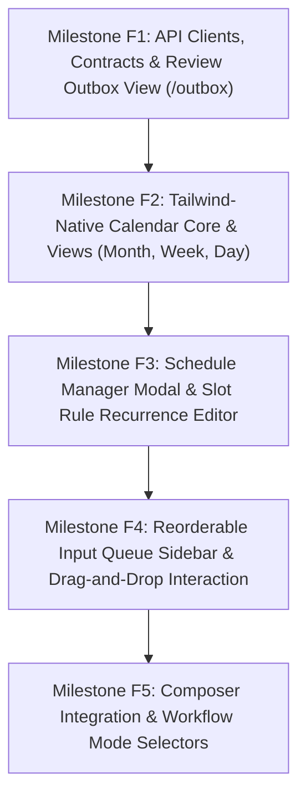

# Frontend Implementation Plan: Scheduled Publishing & Content Calendar Engine

## Overview
This document specifies the phased frontend implementation of social-worker's Content Calendar & Scheduled Publishing Engine. It details the Tailwind-Native CSS Grid Calendar, the dedicated Review Outbox triage dashboard, drag-and-drop queue management, and Composer integration.

---

## Milestone Summary & Dependencies



---

## Milestone F1: API Clients, Contracts & Review Outbox View (`/outbox`)

### Goal
Establish TypeScript data contracts, REST API clients for schedules, slots, queues, and the outbox, and implement the dedicated Review Outbox triage page for workflows running in `Manual` mode.

### Deliverables
1. **API Contracts & Clients** (`web/src/api/`):
   - `schedules.ts`:
     - Types: `ScheduleDto`, `ScheduleSlotRuleDto`, `ScheduleQueueItemDto`, `CalendarEventDto`, `CalendarSlotWindowDto`.
     - Methods: `getSchedules`, `createSchedule`, `updateSchedule`, `deleteSchedule`, `getSlotRules`, `createSlotRule`, `deleteSlotRule`, `getScheduleQueue`, `enqueuePlatformThread`, `reorderScheduleQueue`, `removeQueueItem`, `pauseQueueItem`, `getCalendarFeed(start, end)`.
   - `outbox.ts`:
     - Types: `OutboxDraftDto`.
     - Methods: `getOutboxDrafts`, `approveOutboxDraft(draftId, action, scheduleId?)`, `discardOutboxDraft(draftId)`.
   - Update `workflows.ts`:
     - Add `publishingMode: "Manual" | "Automatic" | "Scheduled"` and `scheduleId?: string | null` to `WorkflowDestinationDto`.
2. **Review Outbox View** (`web/src/components/Outbox/`):
   - `ReviewOutboxPage.tsx`:
     - Card-based feed displaying workflow drafts awaiting manual review.
     - Origin badge (e.g. `⚡ AI Tech Feed Workflow`), source citation link, thread segments preview.
     - Quick action toolbar:
       - `[Approve & Add to Schedule ▾]` (dropdown of user schedules).
       - `[Publish Now]` (immediate publish).
       - `[Edit in Composer]` (opens Composer).
       - `[Dismiss]` (archives/deletes).
3. **App Header & Navigation** (`web/src/components/Navigation/AppHeader.tsx`):
   - Add `Outbox` navigation link with dynamic pending badge counter (e.g. `Outbox (3)`).
   - Route mapping in `web/src/App.tsx` (`/outbox`).

### Blast Radius Assessment
- **Component**: Navigation and new top-level route `/outbox`.
- **Risk**: Minimal. Does not mutate existing Composer, Drafts page, or Settings.
- **Safety Guarantees**:
  - Outbox is an isolated route. If the outbox endpoint is unavailable, other pages load unaffected.

### Testing Required to Proceed (Gate F1)
- [ ] **Typecheck**: `npm run typecheck` passes with zero TypeScript errors.
- [ ] **Unit Tests (`ReviewOutboxPage.test.tsx`)**:
  - Renders list of outbox drafts with source links and segments.
  - Approve button triggers API call and removes card from feed.
  - Publish Now triggers immediate publish call.
  - Dismiss button triggers delete and updates badge count.
- [ ] **Build Command**:
  ```bash
  docker compose --profile tooling run --rm web-test "npm run build && npm run typecheck"
  ```

---

## Milestone F2: Tailwind-Native Calendar Core & Views (Month, Week, Day)

### Goal
Implement a high-performance, dark-theme native Tailwind CSS Grid Calendar supporting Month, Week, and Day views that visualizes Slot Windows, sub-slot pacing, social media post cards, and empty slot placeholders.

### Deliverables
1. **Calendar View Container** (`web/src/components/Calendar/CalendarPage.tsx`):
   - Active Schedule Selector dropdown.
   - Schedule timezone badge (e.g. `Europe/London (UTC+1)`).
   - View mode toggle: `[ Day | Week | Month ]`.
   - Date range navigation (`[<] [Today] [>]`, Month/Year header).
   - "+ New Schedule" and "Edit Schedule" action buttons.
2. **Month View (`MonthView.tsx`)**:
   - 7-column CSS grid (`grid-cols-7`).
   - Day cells with day numbers, month indicators, and today highlight.
   - Slot window status pills (e.g. `09:00 - 10:00 [4/4]`).
   - Sub-slot dots indicating scheduled platform posts (blue dot for Bluesky, navy dot for LinkedIn).
3. **Week View (`WeekView.tsx`)**:
   - 7-column time-grid with 24-hour rows.
   - Slot window bounding blocks spanning `StartTime` to `EndTime`.
   - Discrete sub-slot cards rendered within the window at equal interval offsets.
4. **Day View (`DayView.tsx`)**:
   - Detailed vertical timeline.
   - Slot window headers with capacity bars (`3/4 filled`).
   - Expanded sub-slot post cards:
     - Platform icon badge (🦋 Bluesky, 💼 LinkedIn).
     - Account handle (`@tech.bsky.social`).
     - Post title and text snippet.
     - Publishing status badge (`Queued`, `Dispatched`, `Sent`, `Failed`).
     - Action menu (Edit in Composer, Remove from slot).
   - Empty sub-slot drop targets (`+ Queue Draft`).

### Blast Radius Assessment
- **Component**: New top-level route `/calendar`.
- **Risk**: Isolated view. No mutation of existing core editor or draft workflows.
- **Visual Alignment**: Must match existing palette: `bg: #0f1115`, `panel: #161922`, `border: #262a36`, `accent: #7c8cff`.

### Testing Required to Proceed (Gate F2)
- [ ] **Unit Tests (`CalendarPage.test.tsx`, `DayView.test.tsx`, `WeekView.test.tsx`, `MonthView.test.tsx`)**:
  - View switcher toggles between Day, Week, and Month cleanly.
  - Date navigation buttons accurately advance and rewind time windows.
  - Slot windows render at calculated time offsets.
  - Empty sub-slot placeholders render when capacity exceeds queued posts.
- [ ] **Timezone Tests**:
  - Validates date math handles month boundaries (e.g. Aug 31 -> Sep 1) and leap years.

---

## Milestone F3: Schedule Manager Modal & Slot Rule Recurrence Editor

### Goal
Build modal dialogs for creating and managing schedules and defining hierarchical slot windows with Start Time, End Time, Post Capacity, and recurrence cadences (Daily, Weekly, Monthly, Yearly).

### Deliverables
1. **`ScheduleManagerModal.tsx`** (`web/src/components/Calendar/`):
   - Schedule Name input.
   - Searchable IANA Timezone select (defaults to user browser timezone, e.g. `America/New_York`, `Europe/London`, `UTC`).
   - Active status toggle.
   - List of currently configured slot rules for this schedule.
   - "Add Slot Rule" button opening the rule editor.
2. **`SlotRuleFormModal.tsx`** (`web/src/components/Calendar/`):
   - **Time Range**:
     - `StartTime` input (native `<input type="time">`).
     - `EndTime` input (native `<input type="time">`).
   - **Post Capacity**:
     - Number input / incrementer (1 to 10 posts).
   - **Live Pacing Preview**:
     - Dynamically calculates:
       $$\text{Interval} = \frac{\text{EndTime} - \text{StartTime}}{\text{PostCapacity}}$$
     - Displays formatted string:
       - *"Publishes 1 post every 15 minutes between 09:00 and 10:00"*
       - *"Publishes 1 post at 08:30"* (if single capacity).
   - **Recurrence Type Selector**:
     - `Daily`: every day.
     - `Weekly`: interactive day toggles `[M] [T] [W] [T] [F] [S] [S]`.
     - `Monthly`: Day of Month (1-31) or Nth Weekday (1st Monday, 2nd Tuesday, Last Friday).
     - `Yearly`: Month + Day.
3. **Confirmation Modals**:
   - Confirm deletion of schedule (with warning about unassigning queued posts).
   - Confirm deletion of slot rule.

### Blast Radius Assessment
- **Component**: Calendar modal components.
- **Risk**: Minimal. Operates on dedicated `/api/schedules` endpoints.
- **Validation**: Strict validation preventing `EndTime < StartTime` or `Capacity < 1`.

### Testing Required to Proceed (Gate F3)
- [ ] **Unit Tests (`ScheduleManagerModal.test.tsx`, `SlotRuleFormModal.test.tsx`)**:
  - Live interval calculation updates correctly when StartTime, EndTime, or Capacity change.
  - Validation blocks submission if EndTime is before StartTime.
  - Weekly day-of-week toggles accurately toggle bitmasks/arrays.
  - Form submit generates expected API payload.

---

## Milestone F4: Reorderable Input Queue Sidebar & Drag-and-Drop Interaction

### Goal
Implement the calendar sidebar showing the schedule's Input Queue, allowing drag-and-drop reordering of queue items and dragging drafts directly into empty calendar sub-slots.

### Deliverables
1. **`QueueSidebar.tsx`** (`web/src/components/Calendar/`):
   - Displays ordered list of pending posts in FIFO order.
   - Visual card per queue item:
     - Drag handle.
     - Draft title + platform badge.
     - Calculated next slot timestamp preview (e.g. `Assigned: Today 09:15`).
     - Action icons: Pause/Resume toggle, Remove from Queue.
   - "+ Add Draft to Queue" button opening `DraftPickerModal`.
2. **`DraftPickerModal.tsx`**:
   - Modal displaying user's existing unassigned drafts/variants.
   - Quick search and platform filter.
   - Clicking a draft appends it to the schedule queue.
3. **Drag-and-Drop Implementation**:
   - Implement priority reordering within the sidebar:
     - Dragging an item from position #3 to position #1 calls `/api/schedules/{id}/queue/reorder` with the new ID order.
     - Instant optimistic UI update.
   - Drag-to-slot interaction:
     - Dragging an item from the sidebar and dropping it onto an empty sub-slot in Day or Week view assigns it to that slot.

### Blast Radius Assessment
- **Component**: Calendar page sidebar and drag interaction.
- **Risk**:
  - Optimistic UI desynchronization: If reorder API fails, revert state and show error toast.
- **Safety Guarantees**:
  - Clean error handling with rollback on API failure.

### Testing Required to Proceed (Gate F4)
- [ ] **Unit Tests (`QueueSidebar.test.tsx`, `DraftPickerModal.test.tsx`)**:
  - Reordering items triggers `reorderScheduleQueue` with updated array.
  - Pause button toggles item paused state.
  - Remove button triggers removal and removes card from queue.
  - Draft picker adds selected draft to queue.

---

## Milestone F5: Composer Integration & Workflow Mode Selectors

### Goal
Integrate scheduling capabilities into the primary Composer publishing bar via a smart split button and update the Workflow creation modal with the 3 publishing modes.

### Deliverables
1. **Composer Split Publishing Button** (`web/src/components/EditorPanel/EditorPanelHeader.tsx`):
   - Replace standard "Publish" button with a split button:
     - Primary button: `Publish Now` (maintains existing immediate publish behavior).
     - Dropdown menu trigger (`ChevronDown`):
       - `Add to Schedule: "[Active Schedule]" (Next slot: Today 09:15)`.
       - List of other configured user schedules.
       - `Manage Schedules...` (navigates to `/calendar`).
   - When a draft/thread is already queued in a schedule:
     - Header displays an informational banner/pill:
       - `🕒 Queued in [Schedule Name] for [Formatted Slot Time]`.
       - Action: `[Remove from Schedule]`.
2. **Workflow Destination Mode Selectors** (`web/src/components/WorkflowsPanel/WorkflowFormModal.tsx`):
   - Replace simple `AutoPublish` checkbox with a 3-way radio card selector for each destination:
     - **Manual Review**: `"Drafts go to the Review Outbox for editorial approval"`.
     - **Automatic Publish**: `"Instantly publish the moment generation completes"`.
     - **Add to Schedule**: `"Queue into a schedule for paced calendar delivery"` + Schedule picker dropdown.
3. **Draft Cards Badging** (`web/src/components/Drafts/DraftCard.tsx` & `DraftVariantTabs.tsx`):
   - Show `Scheduled` / `Queued` badge with schedule name and slot tooltip.

### Blast Radius Assessment
- **Component**: Core Composer editor header and Workflow modal.
- **Critical Invariant**:
  - Existing immediate publishing flow (`Publish Now`) must remain 100% operational and unchanged.
  - Existing workflows must load cleanly with their migrated `PublishingMode`.

### Testing Required to Proceed (Gate F5)
- [ ] **Unit Tests (`EditorPanelHeader.test.tsx`, `WorkflowFormModal.test.tsx`)**:
  - `Publish Now` clicks invoke `publish()` directly without interruption.
  - Split button menu items correctly call `enqueuePlatformThread`.
  - Workflow modal mode changes update form state and display schedule dropdown when `Scheduled` is selected.
- [ ] **Full Frontend Suite**:
  ```bash
  docker compose --profile tooling run --rm web-test
  ```
- [ ] **Full Build & Typecheck**:
  ```bash
  docker compose --profile tooling run --rm web-test "npm run build && npm run typecheck"
  ```
